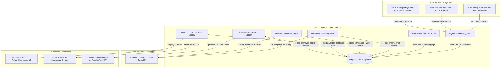
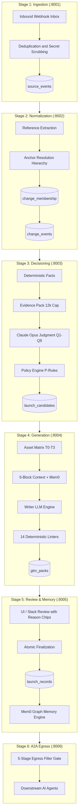
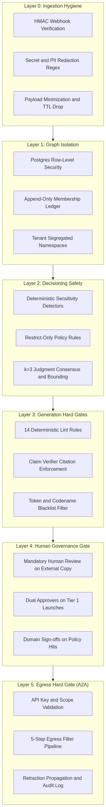
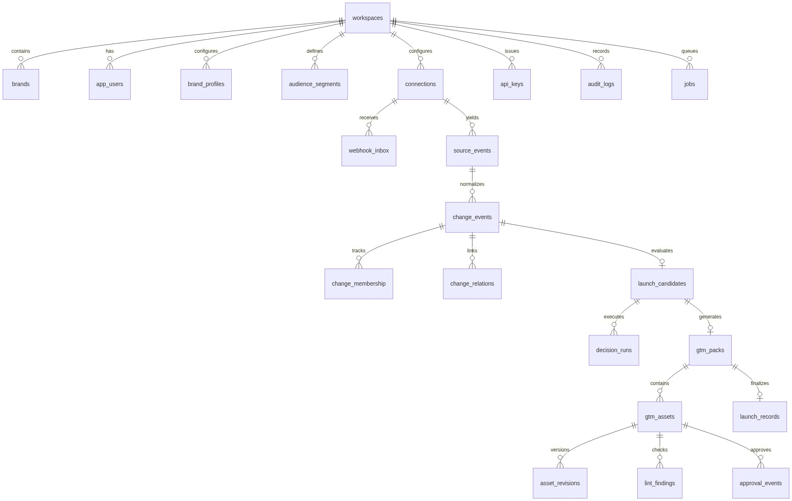
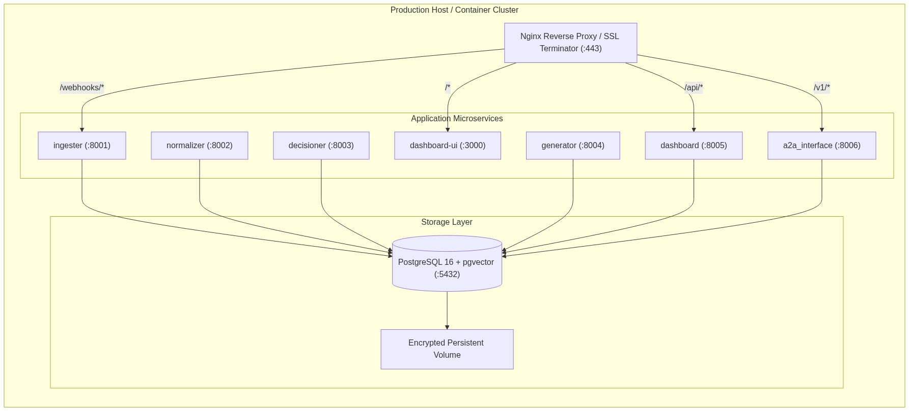

# LaunchGraph V1 — High-Level Design (HLD)

> **Document Status:** Authoritative Architecture Reference  
> **Target Version:** LaunchGraph V1 (GTM Context Graph Platform)  
> **Source Material:** [Master PRD & Architecture Review](file:///d:/Projects/Emiva/code/new-03-4-26/emiva/docs/resources/Emiva_V1_Master_PRD_and_Architecture_Review.md), [Phase 1 Red Team](file:///d:/Projects/Emiva/code/new-03-4-26/emiva/docs/resources/Phase_1_Red_Team_and_Redesign.md), [Phase 2 Improvement Sweep](file:///d:/Projects/Emiva/code/new-03-4-26/emiva/docs/resources/Phase_2_Improvement_Sweep.md), [Phase 3 Master PRD](file:///d:/Projects/Emiva/code/new-03-4-26/emiva/docs/resources/Phase_3_Master_PRD.md)  
> **Scientific Base Reference:** [Mem0: Building Production-Ready AI Agents with Scalable Long-Term Memory (Chhikara et al., 2025)](file:///d:/Projects/Emiva/code/new-03-4-26/emiva/docs/resources/Mem0-Agent%20Long%20Term%20memory.pdf)  
> **Companion Documents:** [Low-Level Design (LLD)](file:///d:/Projects/Emiva/code/new-03-4-26/emiva/docs/LLD.md) | [Progress Tracker](file:///d:/Projects/Emiva/code/new-03-4-26/emiva/docs/PROGRESS_TRACKER.md)

---

## 1. Executive Summary

### 1.1 The Problem
High-velocity software engineering teams ship dozens of pull requests, tickets, and features every week across GitHub, Jira, and Slack. However, Go-To-Market (GTM) teams—Product Marketing Managers (PMMs), Developer Relations, Sales Enablement, and Customer Support—operate with severe information lag:
1. **Scattered Evidence:** Product changes are fragmented across commit diffs, ticket comments, and transient Slack discussions.
2. **Launch Fatigue & Misclassification:** Minor fixes get over-hyped while critical, revenue-driving capabilities slip into changelogs unnoticed.
3. **Draft Hallucinations:** Generative AI tools attempting to draft marketing copy invent unreleased features, leak internal project codenames, or violate compliance/pricing boundaries.
4. **Agent Amnesia & Context Window Degradation:** Downstream autonomous agents (social posters, newsletter generators, support bots) lack an authoritative, persistent memory of what actually launched. Passing raw historical logs into prompts causes severe context window degradation, high latency, and hallucinations.

### 1.2 The LaunchGraph Solution
**LaunchGraph** is an enterprise GTM Context Graph platform that ingests raw development events from Jira, GitHub, and Slack, synthesizes them into an anchored, typed context graph of product changes, deterministically classifies launch tiers ($T0$–$T3$), generates grounded GTM asset packs governed by 14 deterministic safety linters, routes packs through strict human approval workflows, captures finalized launches into a persistent long-term memory layer (grounded in the **Mem0** and **Mem0g** architecture), and securely exposes them to downstream AI agents via a read-only Agent-to-Agent (A2A) protocol.

### 1.3 Core V1 Goals & Success Metrics
* **Deterministic Precision:** Attach link precision $\ge 99\%$ before any automated graph merging.
* **Zero Leakage:** $100\%$ recall on deterministic safety linters ($E4$), $0\%$ prompt injection escalation ($E5$), and $100\%$ blocking on egress filter leaks ($E6$).
* **Human-in-the-Loop Governance:** People confirm launch tiers for all notable changes and approve every external asset prior to egress.
* **Scalable Long-Term Memory (Mem0 Basis):** Grounded long-term memory utilizing dynamic extraction, update operations (`ADD`, `UPDATE`, `DELETE`, `NOOP`), and dual retrieval, achieving $\ge 90\%$ token savings and $91\%$ lower p95 latency over full-context approaches.
* **Autonomous Ingestion & Pipeline:** Reliable event-driven and polling-based synchronization with zero Slack conversation history crawling.

---

## 2. System Context

LaunchGraph operates as the central nervous system connecting developer activity to marketing execution. It isolates internal development clutter from public GTM messaging.

---

## 3. Architecture Overview

### 3.1 Five-Stage Processing Pipeline
LaunchGraph processes product telemetry through five sequential stages, designed with autonomous, decoupled worker loops backed by transactional database state:

### 3.2 Service Topology
The backend is structured as a collection of specialized services sharing `launchgraph_core`:

| Service Name | Port | Primary Responsibility | Concurrency / Worker Pattern |
|:---|:---:|:---|:---|
| **`launchgraph_core`** | — | Shared database models (`Base`), Alembic migrations, database connection pooling, encryption helpers, Mem0 memory types, and settings. | Python package imported by all services. |
| **`ingester`** | `8001` | Ingress webhook receiver for GitHub, Jira, and Slack; HMAC verification, secret scrubbing, and deduplicated writing to `webhook_inbox` and `source_event`. | FastAPI server + background reconciliation jobs. |
| **`normalizer`** | `8002` | Reference extraction (Jira keys, PR numbers, commits), anchor selection, typed links (L1–L8), suggestion scoring, and append-only ledger processing. | Autonomous `process -> sleep` loop (`is_processed = False`). |
| **`decisioner`** | `8003` | Deterministic fact building, sensitivity detector scans, evidence pack assembly (12k token cap), Judgment interface execution ($Q1$–$Q9$, $k=3$), policy engine, and tier evaluation. | Autonomous worker loop + LLM client pool. |
| **`generator`** | `8004` | 6-block context assembly, Mem0 few-shot memory injection, LLM generation per asset schema, 14 deterministic lint rules, and claim verifier passes. | Autonomous worker loop + LLM client pool. |
| **`dashboard`** | `8005` | Internal API serving web dashboard, user authentication, review queues, manual overrides, domain approvals, and Slack interactivity webhook handling. | FastAPI REST endpoints + PostgreSQL session pool. |
| **`a2a_interface`** | `8006` | Public Agent-to-Agent protocol service; API key validation, 5-stage egress security filtering, discovery manifest generation, and OpenAPI 3.1 endpoints. | FastAPI high-throughput read-only service. |
| **`dashboard-ui`** | `3000` | Single Page Application (React / Vite) for PMM review, triage, candidate confirmation, asset editing, and quality metrics display. | Static assets served via Nginx / Node.js. |

---

## 4. Core Architectural Principles

1. **PostgreSQL-First & Minimal Sprawl:**  
   PostgreSQL 16 serves as the primary relational store, transactional job coordinator (`FOR UPDATE SKIP LOCKED`), and vector database (`pgvector` for memory embeddings). No unnecessary message brokers (Kafka/RabbitMQ) or separate vector databases are introduced in V1.
2. **Deterministic Where Possible, Probabilistic Only When Necessary:**  
   Hard business rules, reference extraction, link typing, policy checks, and 14 safety lint rules are strictly deterministic code. LLMs are never entrusted with tasks that deterministic code can solve faster, cheaper, and with $100\%$ reliability.
3. **Propose, Never Decide (Human Autonomy Ceiling):**  
   The platform proposes classifications (launch candidate tiers $T0$–$T3$), links, and marketing drafts. Humans confirm tiers for all major and notable changes, approve every external asset, and authorize publishing.
4. **Last Gates Carry the Safety Burden:**  
   Safety cannot rely on prompt instructions alone. Final safety is guaranteed by deterministic linters (L3), human approval gates (L4), and the egress filter (L5) before any data leaves the platform boundary.
5. **Persistent Memory Layer via Mem0 & Mem0g:**  
   Rather than treating past launches as unorganized text chunks (naive RAG) or bloating LLM context windows, LaunchGraph adopts the **Mem0** memory architecture. Memories undergo extraction and dynamic update (`ADD`, `UPDATE`, `DELETE`, `NOOP`) with graph representations ($G = (V, E, L)$) capturing entity relations and timestamps. This enables temporal reasoning while slashing p95 latency by 91% and token cost by over 90%.
6. **Payload Minimization & Minimal Data Footprint:**  
   Raw event payloads are aggressively scrubbed of secrets at ingress. Text fields not needed for GTM drafting are dropped immediately. Slack operates under an events-only posture with zero historical channel crawling.
7. **Strict Per-Tenant Isolation:**  
   All tables include `workspace_id`. PostgreSQL Row-Level Security (RLS) is applied to all tenant tables. Cross-tenant data sharing, shared model training, and cross-workspace memory retrieval are strictly prohibited.

---

## 5. Stage Pipeline Architecture

### Stage 1: Ingestion
* **Connectors:**
  * **Jira:** Connects via OAuth 2.0 3LO; registers dynamic webhooks (`jira:issue_created`, `jira:issue_updated`, `version_released`); runs scheduled weekly webhook refresh and out-of-band reconciliation.
  * **GitHub:** Integrates as a GitHub App; receives webhooks (`pull_request.closed`, `push`, `release.published`); runs an hourly redelivery sweeper to guarantee delivery during webhook outages.
  * **Slack:** Subscribes strictly to Events API on explicitly opt-in public channels; supports message shortcuts for manual change promotion; zero historical conversation harvesting.
* **Deduplication & Hygiene:**
  * Webhook signatures verified via provider HMAC-SHA256 secrets before reading bodies.
  * Ingress payloads hashed and deduplicated at `webhook_inbox` via deterministic idempotency keys.
  * Secret scrubber sanitizes API tokens, AWS keys, JWTs, and private keys via regex before persisting to `source_event`.
  * Retention sweep purges raw payloads older than workspace TTL policy (default 30 days for Slack text).

### Stage 2: Normalization & Graph Assembly
* **Reference Extraction:** Regular expressions extract canonical Jira keys (`[A-Z][A-Z0-9]+-[0-9]+`), PR numbers (`#\d+`), commit SHAs, and URLs from titles, descriptions, and commit messages.
* **Typed Links ($L1$–$L8$):** Assigns precise semantic relationship types:
  * $L1$ (`implements`): PR directly implements a Jira ticket.
  * $L2$ (`mentions`): Informal reference in PR description or comment.
  * $L3$ (`fixes`): PR explicitly closes/fixes a defect ticket.
  * $L4$ (`reverts`): Git revert commit or ticket reverting a prior change.
  * $L5$ (`contains`): Release or Epic containing child issues/PRs.
  * $L6$ (`relates_to`): Sibling relationship or dependency.
  * $L7$ (`duplicate_of`): Redundant ticket or PR.
  * $L8$ (`blocks`): Hard dependency gating another ticket.
* **Anchor Resolution:** Organizes each `change_event` around a single primary anchor entity:
  * *Hierarchy:* Jira Epic $\to$ Jira Issue $\to$ GitHub PR $\to$ Promoted Slack Thread.
* **Membership Ledger:** Changes and their attachments are maintained in an append-only ledger (`change_membership`). Items are never silently deleted; unlinking records an audit entry with user identity and rationale.
* **Deterministic Suggestion Scoring:** When links are unconfirmed, suggestions are ranked using an explicit formula:
  $$\text{Score} = 0.35 \times \text{SamePerson} + 0.20 \times \text{TimeProximity} + 0.25 \times \text{PathPrior} + 0.20 \times \text{TextSimilarity}$$
  Suggestions above threshold are staged for human confirmation in the Unlinked Queue.
* **Lifecycle States:** Tracks lifecycle state (`discovered` $\to$ `draft` $\to$ `in_progress` $\to$ `ready_for_review` $\to$ `merged` / `closed`) and product availability (`unknown`, `internal`, `beta`, `plan_limited`, `ga`).

### Stage 3: Decisioning & Tier Proposals
* **Deterministic Fact Extraction:** Extracts objective metrics (changed file count, test results, documentation presence, author identity, release status) directly from source events.
* **Sensitivity Detectors:** Deterministic scans inspect evidence for security CVEs, customer names/NDAs, compliance/regulatory flags, and pricing/monetization alterations.
* **Evidence Pack Assembly:** Aggregates facts, tickets, and PR summaries into a strictly bounded evidence pack capped at $12,000$ tokens, organized by chunk ID and trust label (`internal` vs `external`).
* **The Judgment Interface:** A swappable contract executing 9 structured questions ($Q1$–$Q9$) over the evidence pack:
  * Sampled $k=3$ times across temperature variation to compute confidence bands (`high`, `medium`, `low`).
  * Questions evaluate user impact, capability type, breaking changes, audience segment, and preliminary tier recommendation.
* **Policy Engine:** Evaluates workspace policy rules ($P\text{-SEC}$, $P\text{-CUST}$, $P\text{-EMBARGO}$, $P\text{-COMPL}$, $P\text{-DEPR}$, $P\text{-INTERNAL}$, etc.).
  * *Restrict-Only Semantics:* Policy rules can only escalate tiers (e.g., $T3 \to T1$) or add mandatory approvers/blockers. No policy rule is permitted to loosen a safety constraint.
* **Deterministic Tier Function:** Combines deterministic facts, $Q1$–$Q9$ consensus, and policy hits to propose a final launch candidate tier:
  * $T0$ (Internal/No external GTM)
  * $T3$ (Minor Changelog update)
  * $T2$ (Notable product feature)
  * $T1$ (Major strategic product launch)

### Stage 4: GTM Pack Generation
* **Tier-Based Asset Matrix:** Generates marketing assets strictly matching the approved tier:
  * **$T0$:** Internal Release Brief only.
  * **$T3$:** Changelog entry, short product snippet.
  * **$T2$:** Changelog, Customer Email, Sales Enablement snippet, Support FAQ, Internal Brief.
  * **$T1$:** Changelog, Customer Email, LinkedIn announcement, Sales Enablement snippet, Support Runbook/FAQ, Internal Launch Brief, Product Blog draft.
* **6-Block Context Assembly with Mem0 Retrieval:** Assembles the prompt context for the LLM writer:
  1. *Brand Profile & Voice Rules* (`brand_profile`)
  2. *Audience Persona & Pain Points* (`audience_segment`)
  3. *Normalized Change Summary & Evidence Pack*
  4. *Decisioning Rationale & Fact Sheet*
  5. *Allowed & Disallowed Claims* (Hard boundaries)
  6. *Mem0 Dual-Retrieved Memory Examples:* Past launch records and approved phrasing retrieved using Mem0's dual strategy (entity-centric subgraph + dense semantic triplet matching).
* **14 Deterministic Linters:** Validates generated copy prior to staging for review:
  * Codes: `LINT-CODENAME`, `LINT-UNCITED`, `LINT-TOKEN`, `LINT-COMPETITOR`, `LINT-SUPERLATIVE`, `LINT-PRICING`, `LINT-TIMING`, `LINT-EMBARGO`, `LINT-LENGTH`, `LINT-PROFANITY`, `LINT-SECURITY`, `LINT-FORMAT`, `LINT-PERSONA`, `LINT-DISALLOWED-CLAIM`.
* **Claim Verifier:** An independent, secondary verification call checks that every factual assertion in the copy maps directly to an explicit citation chunk in the evidence pack.

### Stage 5: Review, Approval & Mem0 Long-Term Memory Capture
* **Review UI & Reason Chips:** PMMs review generated drafts alongside evidence citations. Edits capture structured reason chips (e.g., `Tone adjusted`, `Technical error corrected`, `Claim deleted`, `Formatting tweaked`).
* **Multi-Party Approval Rules:**
  * $T1$ launches strictly require two independent approvers (e.g., Lead PMM + Product/Eng Lead).
  * Policy hits (e.g., $P\text{-SEC}$) mandate designated domain sign-offs (Security Lead).
* **Finalization Transaction:** An atomic database transaction snapshots the approved assets into an immutable `launch_record`, sets pack status to `FINALIZED`, and updates candidate state.
* **Mem0 Memory Management Engine (Algorithm 1):**
  * When a launch is finalized, candidate facts (feature claims, positioning, audience alignment) are evaluated against existing memory via Mem0's four operations:
    * `ADD`: Stores newly introduced capabilities.
    * `UPDATE`: Augments existing capabilities with new features or deeper details.
    * `DELETE` / Soft-Invalidation: Marks superseded features or retracted claims as obsolete (preserving temporal auditability).
    * `NOOP`: Discards redundant facts already established.
* **Retraction & Post-Approval Alerts:** If code is reverted or an embargo is issued after approval, the Mem0 memory engine updates the relationship state to invalid, and a retraction event is broadcast to the A2A retraction feed.
* **Brand Profile Evolution:** Repeated user edit patterns trigger automated suggestions to evolve `brand_profile` tone and claim rules.

---

## 6. Safety Architecture

LaunchGraph enforces defense-in-depth across 6 distinct architectural safety layers ($L0$–$L5$). Layers $L3$, $L4$, and $L5$ operate as unbreakable hard gates:

### Safety Layer Guarantees
* **External-Safe Invariant:** An asset is marked `is_external_safe = True` if and only if:
  1. All 14 deterministic linters pass with zero blocking errors.
  2. The claim verifier finds zero ungrounded assertions.
  3. All required human approvers have signed off.
  4. No active security or embargo policy vetoes exist.
* **Hard Egress Gate:** The A2A API will refuse to return any pack or bundle item that lacks the `is_external_safe` attestation.

---

## 7. Data Architecture & Mem0 Graph Memory Model

### 7.1 Entity Relationship Domains
The data model comprises 34 normalized tables categorized into four logical domains:

### 7.2 The Mem0g Graph Memory Structure
Grounded in the Mem0g research paper, LaunchGraph represents long-term GTM memory as a directed labeled graph $G = (V, E, L)$:
* **Nodes ($V$):** Product entities (Jira Epics, GitHub PRs, Releases, Feature Claims, Personas). Each node $v \in V$ contains entity type classification, dense semantic embedding vector $e_v$, and creation timestamp $t_v$.
* **Edges ($E$):** Typed semantic relationships $(v_s, r, v_d)$ labeled $r$ (e.g. `implements`, `deprecates`, `delivers_capability`, `targets_persona`).
* **Labels ($L$):** Semantic types assigned to nodes.
* **Dual Retrieval Mechanism:**
  1. *Entity-Centric Retrieval:* Identifies key entities in the query, locates corresponding anchor nodes via cosine similarity, and traverses incoming/outgoing edges to build an anchored contextual subgraph.
  2. *Semantic Triplet Retrieval:* Matches dense query embeddings against textual encodings of relationship triplets, retrieving fine-grained factual connections.

---

## 8. Agent-to-Agent (A2A) Interface

LaunchGraph exposes an agent-native, read-only interface enabling downstream AI agents (social schedulers, documentation updaters, sales bots) to consume verified product launch intelligence.

### 8.1 Protocol & Authentication
* **Protocol:** HTTPS REST compliant with OpenAPI 3.1 and A2A Protocol v1.0.0.
* **Authentication:** Bearer token with SHA-256 hashed API keys (`launchgraph_live_...`).
* **Granular Scopes:** `brand:read`, `launches:read`, `packs:read`, `check:write`.

### 8.2 Endpoints Summary
1. `GET /v1/brand`: Brand voice pillars, tone boundaries, approved messaging vocabulary.
2. `GET /v1/bundle`: Filtered, cursor-paginated list of approved launches within a time range.
3. `GET /v1/pack/{id}`: Full finalized asset pack for a specific launch record.
4. `GET /v1/similar`: Mem0-powered hybrid vector + graph search over historical launch records.
5. `GET /v1/retractions`: Polling feed of retracted or cancelled launches for agent cache invalidation.
6. `POST /v1/check`: Real-time egress validation service for external agent drafts.
7. `GET /.well-known/launchgraph.a2a.json`: Discovery manifest and agent card.

---

## 9. Evaluation & Quality Assurance

LaunchGraph enforces strict, quantifiable evaluation standards wired directly into development milestones.

### 9.1 Evaluation Datasets ($E1$–$E6$)
* **$E1$ (Link Attachment):** 500 gold-standard PR-to-Jira link pairs. Target: $\ge 99\%$ precision.
* **$E2$ (Decisioning & Tiers):** 300 labeled changes testing $Q1$–$Q9$ and tier classification. Target: $\ge 90\%$ weighted tier agreement ($\kappa_w \ge 0.85$).
* **$E3$ (Historical Backtest):** Partner published changelogs mapped to source commits.
* **$E4$ (Lint Recall):** 200 synthetic violation samples. Target: **$100\%$ deterministic recall**.
* **$E5$ (Prompt Injection & Jailbreak):** 150 adversarial prompts injected into PR/ticket bodies. Target: **$0\%$ tier escalation, $0\%$ leaked secrets**.
* **$E6$ (Egress Leakage):** 100 edge-case payloads presented to the A2A egress filter. Target: **$100\%$ blocked**.

### 9.2 Auto-Demotion Mechanism
Any automated workflow (e.g., auto-attaching suggested links or auto-drafting packs) is continuously monitored. If rolling precision drops by more than $2.0\%$ below its gate threshold, the system automatically demotes the feature to propose-only mode and alerts administrators.

---

## 10. Technology Stack & Key Decisions

| Architectural Area | Selected Technology | Decision Rationale & Base Paper Trace |
|:---|:---|:---|
| **Backend Services** | **Python (FastAPI + SQLAlchemy)** | Codebase alignment; rich AI ecosystem, native Pydantic typing, rapid LLM integration. |
| **Relational & Vector DB** | **PostgreSQL 16 + pgvector** | Single operational datastore for relational entities, transactions, and vector search. Simplifies ops and backup. |
| **Memory Architecture** | **Mem0 & Mem0g Framework** | *Chhikara et al. (2025)*: Proves 91% lower p95 latency and >90% token savings compared to full-context / naive RAG, with superior temporal reasoning via graph representations ($G = (V,E,L)$). |
| **Primary LLM** | **Anthropic Claude Opus 5** | Default model across all routes behind Judgment and Writer interfaces. Sonnet 5 adopted only on verified eval parity. |
| **Task Queue / Coordination** | **PostgreSQL `SKIP LOCKED`** | Transactionally safe, eliminates Redis/RabbitMQ sprawl in V1, naturally handles backpressure. |
| **Frontend UI** | **React / Vite / Tailwind** | Responsive PMM dashboard with real-time approval queues and side-by-side asset comparison. |
| **Slack Integration Posture** | **Events API Only** | Zero history crawling; adheres to Slack API terms and enterprise customer privacy expectations. |

---

## 11. Deployment Architecture

---

## 12. Non-Functional Requirements (NFRs)

* **Latency Budgets:**
  * Webhook Ingestion ACK: $< 250\text{ ms}$ (enqueued to `webhook_inbox`).
  * Normalization Processing: $< 5\text{ s}$ per event batch.
  * Decisioning Run: $< 15\text{ s}$ (including $k=3$ LLM calls).
  * Generation Run: $< 30\text{ s}$ per complete GTM pack.
  * Mem0 Search Latency: $< 200\text{ ms}$ ($p95$).
  * A2A API Read Queries: $< 150\text{ ms}$ ($p95$).
* **Availability Target:** $99.9\%$ uptime for Ingestion and A2A Egress services.
* **Cost Controls:** Default workspace LLM budget capped at $\$200/\text{month}$ with automated warning notifications triggered at $80\%$ budget utilization.
* **Volume Assumptions:** Designed to comfortably handle $50$ concurrent development repositories, $500$ commits/day, and $50$ launch candidates/week per workspace.

---

## 13. V1 Scope Boundaries

### 13.1 Included in V1 (P0 Scope)
* Connectors for Jira, GitHub, and Slack (events-only).
* Normalized change event graph with append-only ledger and anchor resolution.
* Decisioning engine with deterministic detectors, $Q1$–$Q9$, and restrict-only policy rules.
* Generation of 9 GTM asset types with 14 deterministic linters and claim verification.
* Review dashboard with per-asset approvals, reason chips, and immutable launch records.
* Mem0 long-term memory layer with extraction, update operations, and dual retrieval.
* Read-only A2A REST API with discovery manifest and 5-stage egress filter.
* Comprehensive evaluation harness ($E1$–$E6$) and gate governance.

### 13.2 Deferred to V2 (Explicit Non-Goals for V1)
* Automated external publishing to social channels or CMS (outside V1 trust budget).
* Visual/image generation (Instagram, banner images).
* Direct crawling of Slack private channels or historical conversation backfill.
* Automated feature flag provider synchronization (LaunchDarkly).
* Full multi-tenant model fine-tuning (all inference runs against base frontier models).
* Multi-brand support within a single workspace (schema is ready, UI deferred).
