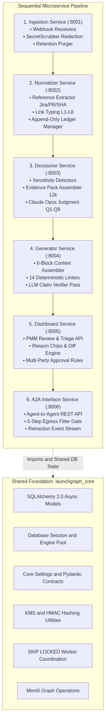
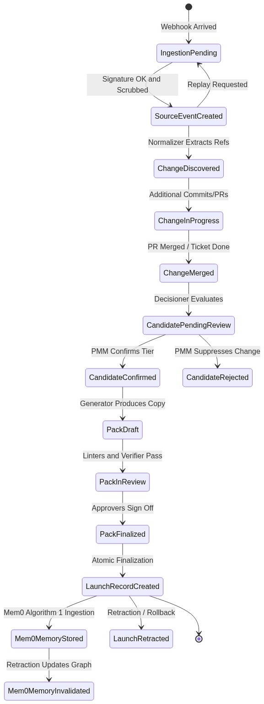
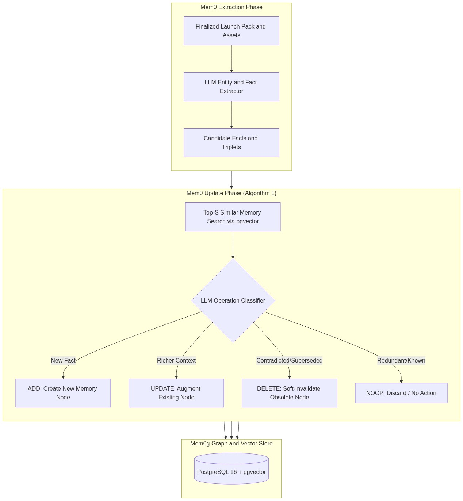

# LaunchGraph V1 - Low-Level Design (LLD)


---

## 1. Service Architecture & Communication

### 1.1 Microservice Boundaries & Responsibilities

The LaunchGraph backend is implemented in Python (Python 3.11+ with FastAPI, SQLAlchemy 2.0 Async, Pydantic v2, and Alembic). Each service operates in an independent process/container, interacting through transactional database state and shared domain primitives in `launchgraph_core`.

<div align="center">



</div>

### 1.2 The Autonomous Worker Pattern (`Process -> Sleep`)

Services that process data asynchronously (`normalizer`, `decisioner`, `generator`) execute autonomous polling loops rather than synchronous RPCs.

```python
async def autonomous_worker_loop(
    service_name: str,
    process_fn: Callable[[AsyncSession], Awaitable[int]],
    poll_interval_seconds: float = 3.0,
    max_batch_size: int = 50
):
    """
    Perpetual background worker loop enforcing backpressure and transactional isolation.
    """
    logger.info(f"Starting worker loop for {service_name}")
    while True:
        try:
            async with get_async_session() as session:
                processed_count = await process_fn(session)
                if processed_count > 0:
                    logger.debug(f"{service_name} processed {processed_count} records.")
                    # If work was found, loop immediately to drain queue without sleeping
                    continue
        except Exception as exc:
            logger.error(f"Error in {service_name} worker loop: {exc}", exc_info=True)
        
        # Backpressure / idle sleep
        await asyncio.sleep(poll_interval_seconds)
```

### 1.3 Job Queue Coordination via PostgreSQL `SKIP LOCKED`

To support parallel workers without duplicate processing or distributed lock contention, worker services utilize transactional PostgreSQL row locking:

```sql
-- Atomically claim up to 10 unprocessed records for a worker
WITH claimable AS (
    SELECT id 
    FROM jobs
    WHERE status = 'pending' 
      AND scheduled_at <= NOW()
    ORDER BY scheduled_at ASC
    LIMIT 10
    FOR UPDATE SKIP LOCKED
)
UPDATE jobs
SET status = 'processing',
    locked_at = NOW(),
    locked_by = :worker_id
WHERE id IN (SELECT id FROM claimable)
RETURNING *;
```

---

## 2. Complete Database Schema

The database consists of 34 normalized tables across four distinct domains, managed via Alembic migrations.

### 2.1 Domain 1: Workspace & Brand Identity

#### `workspaces`
Root multi-tenant container.

| Column | Type | Constraints | Description |
|:---|:---|:---|:---|
| `id` | `UUID` | PK, default `gen_random_uuid()` | Unique workspace identifier |
| `slug` | `VARCHAR(64)` | UNIQUE, NOT NULL | URL-safe workspace slug |
| `name` | `VARCHAR(255)` | NOT NULL | Human-readable company/workspace name |
| `tier` | `VARCHAR(32)` | NOT NULL, default `'pilot'` | Subscription tier: `pilot`, `standard`, `enterprise` |
| `settings` | `JSONB` | NOT NULL, default `'{}'` | Tenant configuration flags, retention TTLs |
| `created_at` | `TIMESTAMPTZ` | NOT NULL, default `NOW()` | Timestamp created |
| `updated_at` | `TIMESTAMPTZ` | NOT NULL, default `NOW()` | Timestamp updated |

#### `brands`
Brand namespace within a workspace.

| Column | Type | Constraints | Description |
|:---|:---|:---|:---|
| `id` | `UUID` | PK, default `gen_random_uuid()` | Unique brand identifier |
| `workspace_id` | `UUID` | FK `workspaces.id` ON DELETE CASCADE | Parent tenant ID |
| `name` | `VARCHAR(255)` | NOT NULL | Brand name |
| `is_default` | `BOOLEAN` | NOT NULL, default `TRUE` | Whether this is the default brand |
| `created_at` | `TIMESTAMPTZ` | NOT NULL, default `NOW()` | Timestamp created |

#### `app_users`
Users authorized to interact with the LaunchGraph platform.

| Column | Type | Constraints | Description |
|:---|:---|:---|:---|
| `id` | `UUID` | PK, default `gen_random_uuid()` | Unique user identifier |
| `workspace_id` | `UUID` | FK `workspaces.id` ON DELETE CASCADE | Associated workspace |
| `email` | `VARCHAR(255)` | NOT NULL, UNIQUE per workspace | User email address |
| `name` | `VARCHAR(255)` | NOT NULL | User full name |
| `role` | `VARCHAR(32)` | NOT NULL | `owner`, `admin`, `pmm`, `reviewer`, `reader` |
| `is_active` | `BOOLEAN` | NOT NULL, default `TRUE` | Account status |
| `created_at` | `TIMESTAMPTZ` | NOT NULL, default `NOW()` | Registration timestamp |

#### `brand_profiles`
The living brand voice, tone guidelines, and messaging rules.

| Column | Type | Constraints | Description |
|:---|:---|:---|:---|
| `id` | `UUID` | PK, default `gen_random_uuid()` | Profile identifier |
| `workspace_id` | `UUID` | FK `workspaces.id` ON DELETE CASCADE, UNIQUE | Associated workspace |
| `brand_id` | `UUID` | FK `brands.id` ON DELETE CASCADE, UNIQUE | Target brand |
| `product_summary` | `TEXT` | NOT NULL | Canonical summary of product capabilities |
| `voice_tone` | `VARCHAR(128)` | NOT NULL | Tone adjectives (e.g. `direct, authoritative, playful`) |
| `tone_rules` | `JSONB` | NOT NULL, default `'[]'` | List of strict voice rules |
| `allowed_claims` | `JSONB` | NOT NULL, default `'[]'` | Whitelisted factual product assertions |
| `disallowed_claims` | `JSONB` | NOT NULL, default `'[]'` | Blacklisted phrases, premature commitments |
| `codenames` | `JSONB` | NOT NULL, default `'[]'` | List of internal codenames to suppress |
| `updated_at` | `TIMESTAMPTZ` | NOT NULL, default `NOW()` | Last modified timestamp |

#### `audience_segments`
Target buyer and user personas for tailor-made marketing copy.

| Column | Type | Constraints | Description |
|:---|:---|:---|:---|
| `id` | `UUID` | PK, default `gen_random_uuid()` | Persona identifier |
| `workspace_id` | `UUID` | FK `workspaces.id` ON DELETE CASCADE | Associated workspace |
| `name` | `VARCHAR(128)` | NOT NULL | Persona name (e.g. `DevOps Lead`, `VP Engineering`) |
| `description` | `TEXT` | NOT NULL | Background and daily focus |
| `pain_points` | `JSONB` | NOT NULL, default `'[]'` | List of frustrations the product addresses |
| `desired_outcomes` | `JSONB` | NOT NULL, default `'[]'` | Success criteria and business metrics |
| `objections` | `JSONB` | NOT NULL, default `'[]'` | Typical hesitations or friction points |
| `created_at` | `TIMESTAMPTZ` | NOT NULL, default `NOW()` | Creation timestamp |

#### `person_identities`
Maps developer identities across external systems to ensure attribution.

| Column | Type | Constraints | Description |
|:---|:---|:---|:---|
| `id` | `UUID` | PK, default `gen_random_uuid()` | Identity record ID |
| `workspace_id` | `UUID` | FK `workspaces.id` ON DELETE CASCADE | Associated workspace |
| `canonical_name` | `VARCHAR(255)` | NOT NULL | Normalized person name |
| `canonical_email`| `VARCHAR(255)` | NULL | Primary email |
| `github_username`| `VARCHAR(128)` | NULL | GitHub handle |
| `jira_account_id`| `VARCHAR(128)` | NULL | Atlassian account ID |
| `slack_user_id`  | `VARCHAR(64)`  | NULL | Slack user ID |
| `created_at`     | `TIMESTAMPTZ`  | NOT NULL, default `NOW()` | Creation timestamp |

---

### 2.2 Domain 2: Ingestion Sources & Context Graph

#### `connections`
Configuration and credentials for third-party developer platforms.

| Column | Type | Constraints | Description |
|:---|:---|:---|:---|
| `id` | `UUID` | PK, default `gen_random_uuid()` | Connection ID |
| `workspace_id` | `UUID` | FK `workspaces.id` ON DELETE CASCADE | Associated workspace |
| `source_type` | `VARCHAR(32)` | NOT NULL | `JIRA`, `GITHUB`, `SLACK` |
| `status` | `VARCHAR(32)` | NOT NULL | `ACTIVE`, `ERROR`, `DISCONNECTED`, `SYNCING` |
| `credentials` | `BYTEA` | NOT NULL | KMS-encrypted OAuth tokens / app secrets |
| `config` | `JSONB` | NOT NULL, default `'{}'` | Webhook URLs, channel IDs, repo lists |
| `last_synced_at`| `TIMESTAMPTZ` | NULL | Last successful synchronization timestamp |
| `error_message` | `TEXT` | NULL | Error details if connection in `ERROR` status |
| `created_at` | `TIMESTAMPTZ` | NOT NULL, default `NOW()` | Creation timestamp |

#### `webhook_inbox`
Raw, append-only buffer for incoming webhook notifications.

| Column | Type | Constraints | Description |
|:---|:---|:---|:---|
| `id` | `UUID` | PK, default `gen_random_uuid()` | Ingress record ID |
| `connection_id` | `UUID` | FK `connections.id` ON DELETE CASCADE | Receiving connection |
| `idempotency_key`| `VARCHAR(255)`| NOT NULL, UNIQUE per connection | Delivery deduplication key |
| `event_type` | `VARCHAR(128)` | NOT NULL | Provider event type |
| `payload` | `JSONB` | NOT NULL | Raw verified webhook JSON |
| `status` | `VARCHAR(32)` | NOT NULL, default `'pending'` | `pending`, `processed`, `failed`, `dead_letter` |
| `retry_count` | `INTEGER` | NOT NULL, default `0` | Number of processing attempts |
| `received_at` | `TIMESTAMPTZ` | NOT NULL, default `NOW()` | Exact arrival timestamp |

#### `source_events`
Scrubbed and validated development activity events.

| Column | Type | Constraints | Description |
|:---|:---|:---|:---|
| `id` | `UUID` | PK, default `gen_random_uuid()` | Source event ID |
| `workspace_id` | `UUID` | FK `workspaces.id` ON DELETE CASCADE | Associated workspace |
| `connection_id` | `UUID` | FK `connections.id` | Source connection |
| `source_type` | `VARCHAR(32)` | NOT NULL | `JIRA`, `GITHUB`, `SLACK` |
| `external_id` | `VARCHAR(255)` | NOT NULL | Provider ID (PR number, issue key) |
| `trust_label` | `VARCHAR(32)` | NOT NULL, default `'INTERNAL'` | `INTERNAL`, `EXTERNAL_UNTRUSTED` |
| `raw_payload` | `JSONB` | NOT NULL | Sanitized JSON with secrets scrubbed |
| `is_processed` | `BOOLEAN` | NOT NULL, default `FALSE` | Worker consumption flag |
| `created_at` | `TIMESTAMPTZ` | NOT NULL, default `NOW()` | Event timestamp |

#### `change_events`
The primary business entity representing a distinct product change or feature.

| Column | Type | Constraints | Description |
|:---|:---|:---|:---|
| `id` | `UUID` | PK, default `gen_random_uuid()` | Change event identifier |
| `workspace_id` | `UUID` | FK `workspaces.id` ON DELETE CASCADE | Associated workspace |
| `anchor_ref` | `VARCHAR(255)` | NOT NULL | Primary anchor key (e.g. `JIRA:PROJ-1234`) |
| `title` | `VARCHAR(512)` | NOT NULL | Canonical human-readable change title |
| `description` | `TEXT` | NULL | Comprehensive summary of change |
| `state` | `VARCHAR(32)` | NOT NULL, default `'discovered'` | `discovered`, `in_progress`, `merged`, `closed` |
| `availability` | `VARCHAR(32)` | NOT NULL, default `'unknown'` | `unknown`, `internal`, `beta`, `ga` |
| `last_activity_at`| `TIMESTAMPTZ`| NOT NULL, default `NOW()` | Timestamp of newest underlying event |
| `is_processed` | `BOOLEAN` | NOT NULL, default `FALSE` | Decisioner pickup flag |
| `created_at` | `TIMESTAMPTZ` | NOT NULL, default `NOW()` | Graph insertion timestamp |

#### `change_membership`
Append-only ledger binding source events and references to a `change_event`.

| Column | Type | Constraints | Description |
|:---|:---|:---|:---|
| `id` | `UUID` | PK, default `gen_random_uuid()` | Ledger record ID |
| `change_event_id`| `UUID` | FK `change_events.id` ON DELETE CASCADE | Parent change event |
| `source_event_id`| `UUID` | FK `source_events.id` | Attached source event |
| `ref_type` | `VARCHAR(32)` | NOT NULL | `JIRA_ISSUE`, `GITHUB_PR`, `GITHUB_COMMIT`, `SLACK_MSG` |
| `ref_key` | `VARCHAR(255)` | NOT NULL | External identifier string |
| `link_type` | `VARCHAR(32)` | NOT NULL | `implements`, `mentions`, `fixes`, `reverts`, etc. |
| `role` | `VARCHAR(32)` | NOT NULL | `anchor`, `implements`, `release`, `context` |
| `attached_by` | `VARCHAR(64)` | NOT NULL | `'system'` or user UUID |
| `reason` | `TEXT` | NULL | Rationale for link attachment |
| `is_active` | `BOOLEAN` | NOT NULL, default `TRUE` | Soft-deletion flag for audit trail |
| `created_at` | `TIMESTAMPTZ` | NOT NULL, default `NOW()` | Attachment timestamp |

#### `link_suggestions`

Candidate link predictions generated by the ranking formula awaiting human triage.

| Column | Type | Constraints | Description |
|:---|:---|:---|:---|
| `id` | `UUID` | PK, default `gen_random_uuid()` | Suggestion ID |
| `workspace_id` | `UUID` | FK `workspaces.id` ON DELETE CASCADE | Associated workspace |
| `change_event_id`| `UUID` | FK `change_events.id` ON DELETE CASCADE | Target change event |
| `source_event_id`| `UUID` | FK `source_events.id` ON DELETE CASCADE | Unlinked candidate event |
| `score` | `FLOAT` | NOT NULL | Ranked score [0.0 - 1.0] |
| `feature_breakdown`| `JSONB` | NOT NULL | Sub-scores: same_person, time, text, path |
| `status` | `VARCHAR(32)` | NOT NULL, default `'pending'` | `pending`, `accepted`, `rejected` |
| `reviewed_by` | `UUID` | FK `app_users.id`, NULL | Reviewer user ID |
| `reviewed_at` | `TIMESTAMPTZ` | NULL | Triage timestamp |
| `created_at` | `TIMESTAMPTZ` | NOT NULL, default `NOW()` | Prediction timestamp |

#### `change_relations`
High-level graph relationship between two distinct change events.

| Column | Type | Constraints | Description |
|:---|:---|:---|:---|
| `id` | `UUID` | PK, default `gen_random_uuid()` | Relation identifier |
| `workspace_id` | `UUID` | FK `workspaces.id` ON DELETE CASCADE | Associated workspace |
| `source_change_id`| `UUID` | FK `change_events.id` ON DELETE CASCADE | Source change event |
| `target_change_id`| `UUID` | FK `change_events.id` ON DELETE CASCADE | Target change event |
| `relation_type` | `VARCHAR(32)` | NOT NULL | `blocks`, `depends_on`, `supersedes` |
| `created_at` | `TIMESTAMPTZ` | NOT NULL, default `NOW()` | Graph edge timestamp |

---

### 2.3 Domain 3: Candidates, Packs & Governance

#### `launch_candidates`
Evaluation of a `change_event` proposing launch tier and readiness.

| Column | Type | Constraints | Description |
|:---|:---|:---|:---|
| `id` | `UUID` | PK, default `gen_random_uuid()` | Candidate ID |
| `workspace_id` | `UUID` | FK `workspaces.id` ON DELETE CASCADE | Associated workspace |
| `change_event_id`| `UUID` | FK `change_events.id` UNIQUE | Associated change event |
| `tier` | `VARCHAR(16)` | NOT NULL | Proposed tier: `T0`, `T1`, `T2`, `T3` |
| `confirmed_tier` | `VARCHAR(16)` | NULL | Human-confirmed tier |
| `confidence` | `VARCHAR(16)` | NOT NULL | Confidence band: `high`, `medium`, `low` |
| `score` | `INTEGER` | NOT NULL | Numeric impact score (1-100) |
| `reasons` | `JSONB` | NOT NULL, default `'[]'` | Rationale points from Judgment |
| `is_external_safe`| `BOOLEAN` | NOT NULL, default `FALSE` | Whether all safety gates pass |
| `safety_warnings`| `JSONB` | NOT NULL, default `'[]'` | Detector hits and warnings |
| `status` | `VARCHAR(32)` | NOT NULL, default `'PENDING_REVIEW'` | `PENDING_REVIEW`, `CONFIRMED`, `REJECTED`, `SUPPRESSED` |
| `is_processed` | `BOOLEAN` | NOT NULL, default `FALSE` | Generator pickup flag |
| `created_at` | `TIMESTAMPTZ` | NOT NULL, default `NOW()` | Decision timestamp |
| `updated_at` | `TIMESTAMPTZ` | NOT NULL, default `NOW()` | Update timestamp |

#### `decision_runs`
Audit record of an execution of the Stage 3 decisioning pipeline.

| Column | Type | Constraints | Description |
|:---|:---|:---|:---|
| `id` | `UUID` | PK, default `gen_random_uuid()` | Run ID |
| `launch_candidate_id`| `UUID`| FK `launch_candidates.id` ON DELETE CASCADE | Target candidate |
| `model_name` | `VARCHAR(64)` | NOT NULL | Foundation model used (`claude-opus-5`) |
| `k_samples` | `INTEGER` | NOT NULL, default `3` | Sample count |
| `evidence_pack_tokens`| `INTEGER`| NOT NULL | Total tokens consumed |
| `evidence_pack_hash`| `VARCHAR(64)`| NOT NULL | SHA-256 hash of evidence context |
| `raw_answers` | `JSONB` | NOT NULL | Array of $k$ answers per question $Q1$–$Q9$ |
| `policy_hits` | `JSONB` | NOT NULL | Rules triggered during run |
| `created_at` | `TIMESTAMPTZ` | NOT NULL, default `NOW()` | Run timestamp |

#### `gtm_packs`
Parent container for marketing assets generated for a candidate.

| Column | Type | Constraints | Description |
|:---|:---|:---|:---|
| `id` | `UUID` | PK, default `gen_random_uuid()` | GTM pack identifier |
| `workspace_id` | `UUID` | FK `workspaces.id` ON DELETE CASCADE | Associated workspace |
| `launch_candidate_id`| `UUID`| FK `launch_candidates.id` UNIQUE | Parent candidate |
| `status` | `VARCHAR(32)` | NOT NULL, default `'DRAFT'` | `DRAFT`, `IN_REVIEW`, `FINALIZED`, `RETRACTED` |
| `version` | `INTEGER` | NOT NULL, default `1` | Pack iteration count |
| `created_at` | `TIMESTAMPTZ` | NOT NULL, default `NOW()` | Generation timestamp |
| `finalized_at` | `TIMESTAMPTZ` | NULL | Final approval timestamp |

#### `gtm_assets`
Individual marketing deliverables (e.g., Email, LinkedIn post, Changelog).

| Column | Type | Constraints | Description |
|:---|:---|:---|:---|
| `id` | `UUID` | PK, default `gen_random_uuid()` | Asset identifier |
| `gtm_pack_id` | `UUID` | FK `gtm_packs.id` ON DELETE CASCADE | Parent pack |
| `asset_type` | `VARCHAR(32)` | NOT NULL | `CHANGELOG`, `EMAIL`, `LINKEDIN`, `SALES_SNIPPET`, etc. |
| `audience_id` | `UUID` | FK `audience_segments.id`, NULL | Target persona |
| `content_draft` | `TEXT` | NOT NULL | Original AI-generated content |
| `content_final` | `TEXT` | NULL | Human-edited approved content |
| `structured_data`| `JSONB` | NOT NULL, default `'{}'` | Type-specific fields (subject, preview text) |
| `citations` | `JSONB` | NOT NULL, default `'[]'` | Sentence-level evidence chunk links |
| `status` | `VARCHAR(32)` | NOT NULL, default `'DRAFT'` | `DRAFT`, `APPROVED`, `REJECTED` |
| `updated_at` | `TIMESTAMPTZ` | NOT NULL, default `NOW()` | Last modified timestamp |

#### `asset_revisions`
Versioned snapshots of copy revisions created by human reviewers and writers.

| Column | Type | Constraints | Description |
|:---|:---|:---|:---|
| `id` | `UUID` | PK, default `gen_random_uuid()` | Revision identifier |
| `gtm_asset_id` | `UUID` | FK `gtm_assets.id` ON DELETE CASCADE | Parent asset |
| `revision_number`| `INTEGER` | NOT NULL | Sequential version number (1, 2, ...) |
| `content` | `TEXT` | NOT NULL | Snapshot text copy |
| `author_id` | `UUID` | FK `app_users.id` ON DELETE CASCADE | Author user ID |
| `reason` | `TEXT` | NULL | Revision rationale |
| `created_at` | `TIMESTAMPTZ` | NOT NULL, default `NOW()` | Revision timestamp |

#### `lint_findings`
Deterministic safety and style violations detected on generated assets.

| Column | Type | Constraints | Description |
|:---|:---|:---|:---|
| `id` | `UUID` | PK, default `gen_random_uuid()` | Finding identifier |
| `gtm_asset_id` | `UUID` | FK `gtm_assets.id` ON DELETE CASCADE | Target asset |
| `rule_code` | `VARCHAR(64)` | NOT NULL | Linter code (e.g. `LINT-CODENAME`) |
| `severity` | `VARCHAR(16)` | NOT NULL | `BLOCKER`, `WARNING` |
| `message` | `TEXT` | NOT NULL | Human-readable violation description |
| `snippet` | `VARCHAR(255)` | NULL | Offending copy segment |
| `is_overridden` | `BOOLEAN` | NOT NULL, default `FALSE` | Manual PMM override flag |
| `override_reason`| `TEXT` | NULL | Mandatory rationale if overridden |
| `created_at` | `TIMESTAMPTZ` | NOT NULL, default `NOW()` | Detection timestamp |

#### `approval_events`
Audit trail of human reviewer interactions with assets.

| Column | Type | Constraints | Description |
|:---|:---|:---|:---|
| `id` | `UUID` | PK, default `gen_random_uuid()` | Approval event ID |
| `gtm_asset_id` | `UUID` | FK `gtm_assets.id` ON DELETE CASCADE | Associated asset |
| `user_id` | `UUID` | FK `app_users.id` | Acting user |
| `action` | `VARCHAR(32)` | NOT NULL | `APPROVED_AS_IS`, `APPROVED_WITH_EDITS`, `REJECTED` |
| `reason_chips` | `JSONB` | NOT NULL, default `'[]'` | Structured edit reason categories |
| `edit_diff` | `JSONB` | NULL | Token-level character diff |
| `comments` | `TEXT` | NULL | Optional reviewer notes |
| `created_at` | `TIMESTAMPTZ` | NOT NULL, default `NOW()` | Approval timestamp |

#### `launch_records`
Immutable historical snapshot of an approved launch, representing the unit of memory. Grounded in the Mem0 memory model.

| Column | Type | Constraints | Description |
|:---|:---|:---|:---|
| `id` | `UUID` | PK, default `gen_random_uuid()` | Launch record identifier |
| `workspace_id` | `UUID` | FK `workspaces.id` ON DELETE CASCADE | Associated workspace |
| `gtm_pack_id` | `UUID` | FK `gtm_packs.id` UNIQUE | Finalized pack |
| `change_event_id`| `UUID` | FK `change_events.id` | Underlying change |
| `final_tier` | `VARCHAR(16)` | NOT NULL | Confirmed tier (`T1`, `T2`, `T3`) |
| `published_at` | `TIMESTAMPTZ` | NOT NULL, default `NOW()` | Finalization timestamp |
| `summary` | `TEXT` | NOT NULL | Approved launch executive summary |
| `assets_snapshot`| `JSONB` | NOT NULL | Frozen JSON of all finalized assets |
| `embedding` | `vector(1536)`| NULL | pgvector dense embedding for semantic triplet retrieval |
| `mem0_entities` | `JSONB` | NOT NULL, default `'[]'` | Extracted Mem0 entity nodes ($V$) |
| `mem0_relations`| `JSONB` | NOT NULL, default `'[]'` | Extracted Mem0 relationship triplets ($E$) |
| `is_retracted` | `BOOLEAN` | NOT NULL, default `FALSE` | Retraction marker |
| `retracted_at` | `TIMESTAMPTZ` | NULL | Retraction timestamp |
| `retraction_reason`| `TEXT` | NULL | Reason for launch withdrawal |

---

### 2.4 Domain 4: Platform Infrastructure

#### `api_keys`
Cryptographically secured credentials for A2A interface access.

| Column | Type | Constraints | Description |
|:---|:---|:---|:---|
| `id` | `UUID` | PK, default `gen_random_uuid()` | Key ID |
| `workspace_id` | `UUID` | FK `workspaces.id` ON DELETE CASCADE | Associated workspace |
| `name` | `VARCHAR(128)` | NOT NULL | Label (e.g. `SocialBot Agent`) |
| `key_prefix` | `VARCHAR(16)` | NOT NULL | Cleartext prefix (`launchgraph_live_...`) |
| `key_hash` | `VARCHAR(64)` | NOT NULL, UNIQUE | SHA-256 hash of secret key |
| `scopes` | `JSONB` | NOT NULL | Allowed scopes array |
| `last_used_at` | `TIMESTAMPTZ` | NULL | Last egress call timestamp |
| `expires_at` | `TIMESTAMPTZ` | NULL | Expiration timestamp |
| `is_active` | `BOOLEAN` | NOT NULL, default `TRUE` | Active flag |
| `created_at` | `TIMESTAMPTZ` | NOT NULL, default `NOW()` | Creation timestamp |

#### `llm_call_logs`
Financial and performance accounting for every model invocation.

| Column | Type | Constraints | Description |
|:---|:---|:---|:---|
| `id` | `UUID` | PK, default `gen_random_uuid()` | Log ID |
| `workspace_id` | `UUID` | FK `workspaces.id` ON DELETE CASCADE | Associated workspace |
| `service_name` | `VARCHAR(32)` | NOT NULL | Calling service (`decisioner`, `generator`, `mem0`) |
| `model` | `VARCHAR(64)` | NOT NULL | Foundation model invoked |
| `prompt_tokens` | `INTEGER` | NOT NULL | Input tokens billed |
| `completion_tokens`| `INTEGER`| NOT NULL | Output tokens billed |
| `cost_usd` | `NUMERIC(10, 6)`| NOT NULL | Calculated cost in USD |
| `latency_ms` | `INTEGER` | NOT NULL | Elapsed execution time in ms |
| `created_at` | `TIMESTAMPTZ` | NOT NULL, default `NOW()` | Invocation timestamp |

#### `jobs`
Transactional job coordinator supporting PostgreSQL SKIP LOCKED execution.

| Column | Type | Constraints | Description |
|:---|:---|:---|:---|
| `id` | `UUID` | PK, default `gen_random_uuid()` | Job ID |
| `workspace_id` | `UUID` | FK `workspaces.id` ON DELETE CASCADE | Associated workspace |
| `job_type` | `VARCHAR(64)` | NOT NULL | Type identifier (e.g. `reconcile_inbox`) |
| `deduplication_key`| `VARCHAR(255)`| NOT NULL, UNIQUE per workspace | Idempotent deduplication token |
| `payload` | `JSONB` | NOT NULL, default `'{}'` | Job arguments and execution parameters |
| `status` | `VARCHAR(32)` | NOT NULL, default `'pending'` | `pending`, `processing`, `completed`, `failed` |
| `scheduled_at` | `TIMESTAMPTZ` | NOT NULL, default `NOW()` | Scheduled execution time |
| `locked_at` | `TIMESTAMPTZ` | NULL | Worker claim timestamp |
| `locked_by` | `VARCHAR(64)` | NULL | Worker identifier |
| `retry_count` | `INTEGER` | NOT NULL, default `0` | Execution attempts |
| `max_retries` | `INTEGER` | NOT NULL, default `3` | Maximum retry threshold |
| `error_message` | `TEXT` | NULL | Last execution error |
| `created_at` | `TIMESTAMPTZ` | NOT NULL, default `NOW()` | Creation timestamp |
| `updated_at` | `TIMESTAMPTZ` | NOT NULL, default `NOW()` | Last modified timestamp |

#### `audit_logs`
Append-only administrative and security audit trail.

| Column | Type | Constraints | Description |
|:---|:---|:---|:---|
| `id` | `UUID` | PK, default `gen_random_uuid()` | Audit event ID |
| `workspace_id` | `UUID` | FK `workspaces.id` ON DELETE CASCADE | Associated workspace |
| `user_id` | `UUID` | FK `app_users.id` ON DELETE SET NULL, NULL | Acting user |
| `action` | `VARCHAR(64)` | NOT NULL | Administrative action performed |
| `entity_type` | `VARCHAR(64)` | NOT NULL | Target domain entity name |
| `entity_id` | `VARCHAR(64)` | NOT NULL | Target entity primary key |
| `metadata_json`| `JSONB` | NOT NULL, default `'{}'` | Event metadata payload |
| `created_at` | `TIMESTAMPTZ` | NOT NULL, default `NOW()` | Occurrence timestamp |

#### `a2a_request_logs`
Synchronous egress audit log for down-stream agent queries.

| Column | Type | Constraints | Description |
|:---|:---|:---|:---|
| `id` | `UUID` | PK, default `gen_random_uuid()` | Request log ID |
| `workspace_id` | `UUID` | FK `workspaces.id` ON DELETE CASCADE | Associated workspace |
| `api_key_id` | `UUID` | FK `api_keys.id` ON DELETE SET NULL, NULL | Authenticated API key |
| `endpoint` | `VARCHAR(255)` | NOT NULL | Invoked API route |
| `status_code` | `INTEGER` | NOT NULL | HTTP response status code |
| `latency_ms` | `INTEGER` | NOT NULL | Total elapsed roundtrip time |
| `ip_address` | `VARCHAR(64)` | NULL | Caller IP address |
| `created_at` | `TIMESTAMPTZ` | NOT NULL, default `NOW()` | Ingress request timestamp |

#### `egress_filters`
Configured security filters gating data release over the A2A API.

| Column | Type | Constraints | Description |
|:---|:---|:---|:---|
| `id` | `UUID` | PK, default `gen_random_uuid()` | Filter ID |
| `workspace_id` | `UUID` | FK `workspaces.id` ON DELETE CASCADE | Associated workspace |
| `filter_name` | `VARCHAR(64)` | NOT NULL | Security filter identifier |
| `is_enabled` | `BOOLEAN` | NOT NULL, default `TRUE` | Active gate status |
| `config` | `JSONB` | NOT NULL, default `'{}'` | Filter parameters and whitelists |
| `created_at` | `TIMESTAMPTZ` | NOT NULL, default `NOW()` | Configuration timestamp |

#### `policy_rules`
Workspace policy rule enforcing restrict-only semantics on tiers and approvals.

| Column | Type | Constraints | Description |
|:---|:---|:---|:---|
| `id` | `UUID` | PK, default `gen_random_uuid()` | Rule ID |
| `workspace_id` | `UUID` | FK `workspaces.id` ON DELETE CASCADE | Associated workspace |
| `rule_code` | `VARCHAR(64)` | NOT NULL | Unique policy code (e.g. `P-SEC`, `P-CUST`) |
| `name` | `VARCHAR(255)` | NOT NULL | Human-readable rule title |
| `description` | `TEXT` | NOT NULL | Policy intent and compliance background |
| `effect` | `VARCHAR(32)` | NOT NULL, default `'ESCALATE_TIER'` | Restrictive action taken on trigger |
| `condition_expr`| `TEXT` | NOT NULL | Evaluated DSL logic expression |
| `is_active` | `BOOLEAN` | NOT NULL, default `TRUE` | Enforcement toggle |
| `created_at` | `TIMESTAMPTZ` | NOT NULL, default `NOW()` | Policy creation timestamp |

#### `triage_queues`
Work queues for human review of unlinked events, conflicts, and availability.

| Column | Type | Constraints | Description |
|:---|:---|:---|:---|
| `id` | `UUID` | PK, default `gen_random_uuid()` | Queue item ID |
| `workspace_id` | `UUID` | FK `workspaces.id` ON DELETE CASCADE | Associated workspace |
| `queue_type` | `VARCHAR(32)` | NOT NULL | Queue classification: `UNLINKED`, `CONFLICTS`, `AVAILABILITY` |
| `item_ref` | `VARCHAR(255)` | NOT NULL | Target reference key |
| `priority` | `INTEGER` | NOT NULL, default `1` | Processing priority rank |
| `status` | `VARCHAR(32)` | NOT NULL, default `'open'` | Item status: `open`, `resolved`, `dismissed` |
| `assigned_to` | `UUID` | FK `app_users.id` ON DELETE SET NULL, NULL | Assigned reviewer user ID |
| `created_at` | `TIMESTAMPTZ` | NOT NULL, default `NOW()` | Queue entrance timestamp |

#### `rate_limits`
Sliding window rate limit counters per workspace and API key.

| Column | Type | Constraints | Description |
|:---|:---|:---|:---|
| `id` | `UUID` | PK, default `gen_random_uuid()` | Counter ID |
| `workspace_id` | `UUID` | FK `workspaces.id` ON DELETE CASCADE | Associated workspace |
| `key_prefix` | `VARCHAR(64)` | NOT NULL | Target client / token prefix |
| `window_start` | `TIMESTAMPTZ` | NOT NULL | Current sliding window anchor |
| `request_count`| `INTEGER` | NOT NULL, default `1` | Recorded requests in active window |
| `created_at` | `TIMESTAMPTZ` | NOT NULL, default `NOW()` | Counter initialization timestamp |

---

### 2.5 Domain 5: Mem0 Long-Term Memory Graph Model

Implements the graph representation $G = (V, E, L)$ and Algorithm 1 operations grounded in Chhikara et al. (2025).

#### `mem0_entity_nodes`
Graph Node $v \in V$ representing an extracted capability, product entity, or persona.

| Column | Type | Constraints | Description |
|:---|:---|:---|:---|
| `id` | `UUID` | PK, default `gen_random_uuid()` | Node identifier |
| `workspace_id` | `UUID` | FK `workspaces.id` ON DELETE CASCADE | Associated workspace |
| `entity_type` | `VARCHAR(64)` | NOT NULL | Node label: `FEATURE`, `TICKET`, `EPIC`, `PERSONA`, `CLAIM` |
| `name` | `VARCHAR(255)` | NOT NULL | Canonical entity title |
| `attributes` | `JSONB` | NOT NULL, default `'{}'` | Structured properties, parameters, specs |
| `embedding` | `vector(1536)`| NULL | pgvector embedding for semantic retrieval |
| `information_score`| `FLOAT` | NOT NULL, default `1.0` | Salience and relevance weight |
| `is_active` | `BOOLEAN` | NOT NULL, default `TRUE` | Validity marker (Algorithm 1 soft-deletion) |
| `invalidated_at`| `TIMESTAMPTZ`| NULL | Timestamp when superseded / deleted |
| `invalidation_reason`| `TEXT` | NULL | Invalidation rationale or retraction link |
| `created_at` | `TIMESTAMPTZ` | NOT NULL, default `NOW()` | Node creation timestamp |
| `updated_at` | `TIMESTAMPTZ` | NOT NULL, default `NOW()` | Last node augmentation timestamp |

#### `mem0_relation_edges`
Graph Edge $e \in E$ representing a directed relationship triplet $(v_s, r, v_d)$ labeled $r$.

| Column | Type | Constraints | Description |
|:---|:---|:---|:---|
| `id` | `UUID` | PK, default `gen_random_uuid()` | Edge identifier |
| `workspace_id` | `UUID` | FK `workspaces.id` ON DELETE CASCADE | Associated workspace |
| `source_node_id`| `UUID` | FK `mem0_entity_nodes.id` ON DELETE CASCADE | Source node $v_s$ |
| `target_node_id`| `UUID` | FK `mem0_entity_nodes.id` ON DELETE CASCADE | Target node $v_d$ |
| `relation_type` | `VARCHAR(64)` | NOT NULL | Relation type $r$: `implements`, `deprecates`, `targets_persona`, `delivers` |
| `weight` | `FLOAT` | NOT NULL, default `1.0` | Relationship affinity weight |
| `attributes` | `JSONB` | NOT NULL, default `'{}'` | Edge metadata |
| `is_active` | `BOOLEAN` | NOT NULL, default `TRUE` | Active edge flag |
| `created_at` | `TIMESTAMPTZ` | NOT NULL, default `NOW()` | Edge creation timestamp |

#### `mem0_memory_operations`
Audit log of Mem0 Algorithm 1 operation executions (`ADD`, `UPDATE`, `DELETE`, `NOOP`).

| Column | Type | Constraints | Description |
|:---|:---|:---|:---|
| `id` | `UUID` | PK, default `gen_random_uuid()` | Audit record ID |
| `workspace_id` | `UUID` | FK `workspaces.id` ON DELETE CASCADE | Associated workspace |
| `launch_record_id`| `UUID` | FK `launch_records.id` ON DELETE CASCADE | Finalized launch triggering memory update |
| `operation_type`| `VARCHAR(16)` | NOT NULL | Algorithm 1 op: `ADD`, `UPDATE`, `DELETE`, `NOOP` |
| `candidate_fact`| `JSONB` | NOT NULL | Evaluated extracted fact triplet |
| `target_node_id`| `UUID` | FK `mem0_entity_nodes.id` ON DELETE SET NULL, NULL | Targeted node (if modified/deleted) |
| `reasoning` | `TEXT` | NULL | LLM classifier justification |
| `executed_at` | `TIMESTAMPTZ` | NOT NULL, default `NOW()` | Operation execution timestamp |

#### `brand_profile_evolutions`
Suggested voice and claim evolutions derived from repeated human reviewer edits.

| Column | Type | Constraints | Description |
|:---|:---|:---|:---|
| `id` | `UUID` | PK, default `gen_random_uuid()` | Evolution suggestion ID |
| `workspace_id` | `UUID` | FK `workspaces.id` ON DELETE CASCADE | Associated workspace |
| `suggested_rules`| `JSONB` | NOT NULL, default `'[]'` | Candidate additions/revisions to tone rules |
| `source_approval_events`| `JSONB`| NOT NULL, default `'[]'` | IDs of approval events informing suggestion |
| `status` | `VARCHAR(32)` | NOT NULL, default `'pending'` | Review status: `pending`, `accepted`, `rejected` |
| `reviewed_by` | `UUID` | FK `app_users.id` ON DELETE SET NULL, NULL | Reviewer user ID |
| `reviewed_at` | `TIMESTAMPTZ` | NULL | Review timestamp |
| `created_at` | `TIMESTAMPTZ` | NOT NULL, default `NOW()` | Suggestion creation timestamp |

---

## 3. Lifecycle State Machines

### 3.1 State Machine Overview
The diagram below illustrates the life cycle of entities across the LaunchGraph pipeline:

<div align="center">



</div>

---

## 4. Stage 1: Ingestion — Detailed Design

### 4.1 Ingress Endpoints & Signature Verification
The Ingestion service exposes dedicated webhook receivers:
* `POST /webhooks/github/{connection_id}`
* `POST /webhooks/jira/{connection_id}`
* `POST /webhooks/slack/{connection_id}`

#### Signature Verification Algorithms
1. **GitHub:**
   ```python
   def verify_github_signature(payload_bytes: bytes, secret: str, header_signature: str) -> bool:
       mac = hmac.new(secret.encode("utf-8"), msg=payload_bytes, digestmod=hashlib.sha256)
       expected = "sha256=" + mac.hexdigest()
       return hmac.compare_digest(expected, header_signature)
   ```
2. **Slack:**
   ```python
   def verify_slack_signature(payload_bytes: bytes, secret: str, timestamp: str, signature: str) -> bool:
       if abs(time.time() - int(timestamp)) > 60 * 5:
           return False
       sig_basestring = f"v0:{timestamp}:{payload_bytes.decode('utf-8')}"
       mac = hmac.new(secret.encode("utf-8"), msg=sig_basestring.encode("utf-8"), digestmod=hashlib.sha256)
       expected = "v0=" + mac.hexdigest()
       return hmac.compare_digest(expected, signature)
   ```

### 4.2 Idempotency Keys
* **GitHub:** `github:{delivery_id}:{event_type}`
* **Jira:** `jira:{issue_id}:{issue_updated_timestamp}`
* **Slack:** `slack:{event_id}`

### 4.3 Secret Scrubbing Engine
Compiled regex patterns scrub secrets to `[REDACTED_SECRET]` before persistence:
* AWS Keys: `(A3T[A-Z0-9]|AKIA|AGPA|AIDA|AROA|AIPA|ANPA|ANVA|ASIA)[A-Z0-9]{16}`
* Generic API Tokens: `(?i)(api[_-]?key|access[_-]?token|auth[_-]?token|secret)[\s:=]+([a-zA-Z0-9_\-]{20,})`
* JWT: `ey[A-Za-z0-9_-]{10,}\.[A-Za-z0-9._-]{10,}\.[A-Za-z0-9._-]{10,}`
* Private Keys: `-----BEGIN [A-Z ]+ PRIVATE KEY-----`

---

## 5. Stage 2: Normalization — Detailed Design

### 5.1 Reference Extraction Specifications
* **Jira Issue Keys:** `\b([A-Z][A-Z0-9]+-[0-9]+)\b`
* **GitHub Pull Requests:** `#([0-9]+)` or `https://github\.com/[^/]+/[^/]+/pull/([0-9]+)`
* **Git Commit SHAs:** `\b([a-f0-9]{7,40})\b`

### 5.2 Link Typing Rules ($L1$–$L8$)
1. $L1$ (`implements`): PR branch name or title contains issue key.
2. $L2$ (`mentions`): Informal reference in PR discussion.
3. $L3$ (`fixes`): Closing keyword (`Fixes #12`, `Closes PROJ-45`).
4. $L4$ (`reverts`): Git revert commit message or ticket marked as reverting.
5. $L5$ (`contains`): Release tag or Jira epic containing child items.
6. $L6$ (`relates_to`): Sibling link in Jira.
7. $L7$ (`duplicate_of`): Duplicate mark in Jira.
8. $L8$ (`blocks`): Hard dependency blocking issue.

### 5.3 Suggestion Ranking Formula
$$\text{Score} = 0.35 \times S_{\text{person}} + 0.20 \times S_{\text{time}} + 0.25 \times S_{\text{path}} + 0.20 \times S_{\text{text}}$$

---

## 6. Stage 3: Decisioning — Detailed Design

### 6.1 Deterministic Fact Gathering & Sensitivity Detectors
Extracts file counts, test status, doc presence, security CVEs, customer names, and pricing flags prior to LLM execution.

### 6.2 The Judgment Interface ($Q1$–$Q9$)
Executes 9 structured questions via Claude Opus 5 with $k=3$ consensus sampling and confidence bands (`high`, `medium`, `low`).

### 6.3 Policy Engine & Deterministic Tier Function
Evaluates 11 restrict-only policy rules ($P\text{-SEC}$, $P\text{-CUST}$, $P\text{-EMBARGO}$, $P\text{-COMPL}$, $P\text{-DEPR}$, $P\text{-INTERNAL}$, etc.), escalating base tiers ($T0$–$T3$) or adding mandatory approval gates.

---

## 7. Stage 4: Generation — Detailed Design

### 7.1 Asset Contracts
Generates 9 asset types: `CHANGELOG`, `EMAIL`, `LINKEDIN`, `SALES_SNIPPET`, `SUPPORT_FAQ`, `INTERNAL_BRIEF`, `PRODUCT_BLOG`, `RELEASE_NOTE`, `X_THREAD`.

### 7.2 6-Block Context Assembly with Mem0 Dual Retrieval
Prompt context constructed with:
1. Brand Profile & Voice
2. Audience Persona
3. Evidence Summary & Pack (12k cap)
4. Decision Rationale & Fact Sheet
5. Allowed / Disallowed Claims
6. **Mem0 Dual-Retrieved Few-Shot Examples:** Retrieves past approved launch copy using Mem0's dual strategy (entity-centric subgraph + dense semantic triplet search), ensuring voice consistency and grounded phrasing without context bloating.

### 7.3 14 Deterministic Linters & Claim Verifier
Drafts must pass: `LINT-CODENAME`, `LINT-UNCITED`, `LINT-TOKEN`, `LINT-COMPETITOR`, `LINT-SUPERLATIVE`, `LINT-PRICING`, `LINT-TIMING`, `LINT-EMBARGO`, `LINT-LENGTH`, `LINT-PROFANITY`, `LINT-SECURITY`, `LINT-FORMAT`, `LINT-PERSONA`, `LINT-DISALLOWED-CLAIM`.

---

## 8. Stage 5: Review, Finalization & Mem0 Long-Term Memory Engine

### 8.1 Multi-Party Approval Rules & Finalization
* $T1$ Major Launches: Dual approver required (Lead PMM + Product/Eng Lead).
* $T2$ Notable Launches: 1 PMM approver.
* Policy Hits: Domain sign-offs enforced.
* Atomic database transaction writes frozen snapshot to `launch_records` with status `FINALIZED`.

### 8.2 The Mem0 Memory Management Engine

Grounded in **Mem0: Building Production-Ready AI Agents with Scalable Long-Term Memory** (*Chhikara et al., 2025*), LaunchGraph uses Mem0's dual-phase memory management architecture (Extraction + Update) rather than naive text RAG.

<div align="center">



</div>

#### Algorithm 1: Memory Update Implementation
```python
async def mem0_update_memory(
    session: AsyncSession,
    candidate_facts: List[CandidateFact],
    workspace_id: UUID
) -> None:
    """
    Implements Mem0 Algorithm 1: Evaluates candidate facts against existing
    memory store to maintain temporal consistency and prevent redundancy.
    """
    for fact in candidate_facts:
        # 1. Retrieve top s=10 semantically similar existing memories
        similar_memories = await retrieve_similar_memories(session, workspace_id, fact.embedding, limit=10)
        
        # 2. Invoke LLM operation classifier (Tool Call interface)
        op_decision = await classify_mem0_operation(fact, similar_memories)
        
        if op_decision.action == "ADD":
            # Create new memory entity node
            new_node = Mem0EntityNode(
                workspace_id=workspace_id,
                entity_type=fact.entity_type,
                name=fact.name,
                attributes=fact.attributes,
                embedding=fact.embedding,
                created_at=datetime.utcnow()
            )
            session.add(new_node)
            
        elif op_decision.action == "UPDATE":
            # Augment existing memory with richer attributes
            target_mem = op_decision.target_memory
            if fact.information_content_score > target_mem.information_content_score:
                target_mem.attributes.update(fact.attributes)
                target_mem.embedding = fact.embedding
                target_mem.updated_at = datetime.utcnow()
                
        elif op_decision.action == "DELETE":
            # Soft-invalidation to preserve temporal auditability
            target_mem = op_decision.target_memory
            target_mem.is_active = False
            target_mem.invalidated_at = datetime.utcnow()
            target_mem.invalidation_reason = f"Superseded by {fact.name}"
            
        elif op_decision.action == "NOOP":
            # Fact already represented without new information
            continue
            
    await session.commit()
```

#### Mem0g Dual-Approach Memory Retrieval
When serving queries for downstream A2A agents (`GET /v1/similar`) or Stage 4 generation (Block 6):
1. **Entity-Centric Retrieval:** Extracts named entities from the query, anchors them to graph nodes $V$, and explores 1-hop and 2-hop edges $E$ to assemble a coherent relational subgraph.
2. **Dense Semantic Triplet Retrieval:** Computes cosine similarity between the query embedding and stored relation triplets $(v_s, r, v_d)$, returning top-$k$ verified facts.
3. **Performance Invariant:** Citing the Mem0 paper, this selective retrieval achieves a **$91\%$ lower p95 latency ($< 200\text{ ms}$)** and **$> 90\%$ token savings** compared to full-context dumping.

---

## 9. Agent-to-Agent (A2A) Interface — Detailed Design

### 9.1 Endpoints
1. `GET /v1/brand`: Brand voice and tone rules.
2. `GET /v1/bundle`: Cursor-paginated approved launches.
3. `GET /v1/pack/{id}`: Detailed pack assets with evidence citations.
4. `GET /v1/similar`: Mem0-powered hybrid vector + graph search.
5. `GET /v1/retractions`: Polling feed for cache invalidation.
6. `POST /v1/check`: Copy linter validation for external agent drafts.
7. `GET /.well-known/launchgraph.a2a.json`: Discovery manifest and agent card.

### 9.2 The 5-Step Egress Filter Pipeline
Every response passes through:
1. **Tenant Isolation:** Workspace validation.
2. **Safety Marker Check:** Refuse delivery if `is_external_safe == False`.
3. **Embargo Check:** Block delivery if current time $< \text{embargo\_timestamp}$.
4. **Secret Scrubber:** Final regex pass for sensitive tokens.
5. **Audit Logging:** Synchronous record in `a2a_request_logs`.

---

## 10. Security & Compliance Implementation

* **PostgreSQL Row-Level Security (RLS):** All queries execute under active tenant setting `app.current_workspace_id`.
* **KMS Envelope Encryption:** OAuth credentials encrypted via AES-GCM with customer-isolated Data Encryption Keys.
* **Prompt Injection Defenses:** Strict boundary separation, input token sanitization, and $E5$ adversarial testing.

---

## 11. Evaluation Harness & Gate Implementation

* **$E1$ Link Precision:** $\ge 99.0\%$ attach precision.
* **$E2$ Decisioning Agreement:** Weighted kappa $\kappa_w \ge 0.85$.
* **$E4$ Deterministic Lint Recall:** $100.0\%$ recall on seeded violations.
* **$E5$ Injection Escape Rate:** $0\%$ leaks or escalations.
* **$E6$ Egress Filter Recall:** $100.0\%$ blocked.
* **Auto-Demotion:** Automatically demotes features if rolling precision drops $> 2\%$ below gate threshold.
