# LaunchGraph V1 — Implementation Progress Tracker

> **Document Status:** Authoritative Engineering Progress & Milestone Tracking  
> **Target Version:** LaunchGraph V1 (GTM Context Graph Platform)  
> **Source Material:** [Master PRD & Architecture Review](file:///d:/Projects/Emiva/code/new-03-4-26/emiva/docs/resources/Emiva_V1_Master_PRD_and_Architecture_Review.md), [Phase 3 Master PRD](file:///d:/Projects/Emiva/code/new-03-4-26/emiva/docs/resources/Phase_3_Master_PRD.md)  
> **Scientific Base Reference:** [Mem0: Building Production-Ready AI Agents with Scalable Long-Term Memory (Chhikara et al., 2025)](file:///d:/Projects/Emiva/code/new-03-4-26/emiva/docs/resources/Mem0-Agent%20Long%20Term%20memory.pdf)  
> **Companion Documents:** [High-Level Design (HLD)](file:///d:/Projects/Emiva/code/new-03-4-26/emiva/docs/HLD.md) | [Low-Level Design (LLD)](file:///d:/Projects/Emiva/code/new-03-4-26/emiva/docs/LLD.md)

---

## 1. Overview & Percentage Progress Model

This document establishes the authoritative, stage-by-stage implementation checklist for LaunchGraph V1. Progress is measured strictly by functional completeness, adherence to frozen contracts, passing evaluation suites, and satisfying integration gates.

```mermaid
gantt
    title LaunchGraph V1 Implementation Progress Roadmap
    dateFormat  X
    axisFormat %s%%
    
    section 0% - 10%
    Batch 0 Contracts & DB Schema :active, 0, 10
    section 10% - 25%
    Wave 1 Ingestion Pipeline (M1) : 10, 25
    section 25% - 40%
    Wave 2 Normalization & Graph (M2) : 25, 40
    section 40% - 55%
    Wave 3A Decisioning Engine : 40, 55
    section 55% - 70%
    Wave 3B Generation & Linters (M3/G0) : 55, 70
    section 70% - 80%
    Wave 4A Review UI & Mem0 Memory Engine : 70, 80
    section 80% - 90%
    Wave 4B A2A Protocol & Egress (M4) : 80, 90
    section 90% - 100%
    Wave 5 Hardening & Pilot Gate (M5/G4) : 90, 100
```

---

## 2. Current Codebase Status Audit

*Engineering milestone assessment conducted on October 2026:*

| Component / Subsystem | Current State in Repository | Milestone Equivalent | Current Completion % |
|:---|:---|:---:|:---:|
| **`launchgraph_core`** | Complete 34 tables defined, SQLAlchemy 2.0 Async models, Alembic migrations baseline, Pydantic v2 contracts, Mem0 graph schemas, and security baseline. | Batch 0 | **100%** of Batch 0 |
| **`ingester`** | Complete FastAPI microservice (:8001), HMAC-SHA256 signature verifiers, idempotency dedupe keys, secret scrubber engine, GitHub, Jira, and Slack webhooks, reconciler, replay storm verified. | Wave 1 | **100%** of Ingestion |
| **`normalizer`** | Autonomous worker loop, deterministic reference extractor (Jira, PR, commit), link typing L1-L8, anchor resolver, append-only membership ledger, suggestion ranking formula, triage queue endpoints. | Wave 2 | **65%** of Normalizer |
| **`decisioner`** | Complete FastAPI microservice (:8003), DeterministicFactExtractor, SensitivityDetector (CVE/NDA/Compliance/Pricing/Embargo), 12k EvidencePackAssembler, Judgment consensus (Q1-Q9, k=3), Restrict-Only PolicyEngine, TierEvaluator, LaunchCandidate and DecisionRun persistence. | Wave 3A | **100%** of Decisioner Core |
| **`generator`** | Contract schemas defined (9 asset types, 14 deterministic linters). Writer service pending. | Wave 3B | **20%** of Generator |
| **`dashboard` / UI** | Data models and approval audit ledger ready. UI views pending. | Wave 4A | **20%** of Dashboard |
| **`a2a_interface`** | Contract schemas and egress filter specifications frozen. Service endpoints pending. | Wave 4B | **15%** of A2A |
| **`mem0_graph` Memory Layer** | Complete graph models (Nodes, Edges, Operations, Evolutions) and Pydantic contracts implemented. | Wave 3B–4B | **35%** of Memory |
| **Evaluation Harness** | Test suite fixtures, replay storm test (1,000 events), unit and integration suites passing (**61 tests passed, 100%**). | Wave 1–5 | **50%** |
| **Aggregate Repo Status** | **Batch 0 (10%), Milestone M1 (25%), Milestone M2 Core (30%), and Stage 3 Decisioning (50%) verified and passing.** | — | **50% Overall** |

---

## 3. Cumulative Percentage Milestones Breakdown

---

### Milestone Checkpoint: 10% Completion [COMPLETED]
#### Target: Batch 0 Contract Freeze & Database Baseline
* **Objective:** Freeze all 13 inter-service contracts and establish the complete PostgreSQL schema with Row-Level Security and Mem0 data structures.
* **Timeline Target:** Weeks 1–2 (Batch 0)

#### Deliverables Checklist:
- [x] **B0.1 Complete Database Schema V1:**
  - [x] All 34 tables defined in `launchgraph_core.db.models` (Workspaces, Connections, SourceEvents, ChangeEvents, ChangeMembership ledger, LaunchCandidates, DecisionRuns, GtmPacks, GtmAssets, LintFindings, ApprovalEvents, LaunchRecords, ApiKeys, AuditLogs, Mem0 graph entities/relations, etc.).
  - [x] Alembic migration scripts applied cleanly (`0001_initial_schema.py`).
  - [x] PostgreSQL Row-Level Security (RLS) policies implemented on `workspace_id`.
  - [x] Append-only trigger rules enforced on `change_membership` and `launch_records`.
- [x] **B0.2 Job Contracts:**
  - [x] Defined schemas, deduplication keys, and retry policies for all job types (`normalize`, `decide`, `generate_asset`, `lint`, `verify`, `finalize`, `mem0_update`, `index_record`, `notify`, `purge`, `reconcile`).
- [x] **B0.3 Connector Contracts & Test Fixtures:**
  - [x] Frozen ingress schemas and HMAC signature test vectors for GitHub, Jira, and Slack.
  - [x] Recorded webhook fixtures stored under `tests/fixtures/webhooks/`.
- [x] **B0.4 Judgment & Policy Contracts:**
  - [x] Frozen definitions for questions $Q1$–$Q9$, evidence pack schema (12k ceiling), and answer schemas.
  - [x] Policy DSL schema with restrict-only effect grammar defined (11 default rules).
- [x] **B0.5 Mem0 Memory Layer Contracts:**
  - [x] Schemas for Mem0 extraction outputs ($\Omega = \{\omega_1, \dots, \omega_n\}$), update operations (`ADD`, `UPDATE`, `DELETE`, `NOOP`), and relationship triplets $(v_s, r, v_d)$.
- [x] **B0.6–B0.8 Asset & API Contracts:**
  - [x] 14 lint codes and finding schemas defined.
  - [x] 9 asset type schemas with character limits frozen.
  - [x] OpenAPI 3.1 contract published for internal app API and external A2A API.
- [x] **B0.12 Security Baseline:**
  - [x] Secret scrubbing regex catalog compiled and tested.
  - [x] KMS envelope encryption design approved and API key hashing implemented.

#### Verification & Exit Criteria:
* `alembic upgrade head` runs without errors on fresh database instance.
* All contract schemas validate cleanly in Pydantic v2.
* Contract freeze review completed and signed off.

---

### Milestone Checkpoint: 25% Completion [COMPLETED]
#### Target: Milestone M1 — "Data In" (Stage 1 Ingestion Live)
* **Objective:** Live event ingestion from GitHub, Jira, and Slack with deduplication, security scrubbing, and reconciliation.
* **Timeline Target:** End of Week 5 (Wave 1)

#### Deliverables Checklist:
- [x] **GitHub Connector:**
  - [x] GitHub App integration receiving webhooks: `pull_request.closed`, `push`, `release.published`.
  - [x] Webhook signature verification (`X-Hub-Signature-256`) via HMAC-SHA256.
  - [x] Hourly redelivery sweeper job querying missed events.
- [x] **Jira Connector:**
  - [x] OAuth 2.0 3LO authorization handshake.
  - [x] Dynamic webhook registration for issues, updates, and releases.
  - [x] Weekly webhook refresh job and out-of-band issue reconciler.
- [x] **Slack Connector:**
  - [x] Slack Events API receiver for explicitly opt-in public channels only.
  - [x] Message action shortcut for manual change promotion.
  - [x] Strict compliance: zero conversation history crawling or channel scraping.
- [x] **Ingress Hygiene & Storage:**
  - [x] Ingress writing to `webhook_inbox` with idempotency deduplication keys.
  - [x] Secret scrubber sanitizing AWS tokens, API keys, private keys, and JWTs.
  - [x] Normalized insertion into `source_events` with trust labels (`INTERNAL` vs `EXTERNAL_UNTRUSTED`).
  - [x] 90-day historical backfill job on connector installation.
  - [x] 30-day retention purge job for raw payload minimization.

#### Verification & Exit Criteria:
* Replay storm test: $1,000$ duplicate and out-of-order webhook events processed with zero duplicate `source_events`.
* One-hour simulated webhook outage recovered automatically via reconciler.
* Zero Slack history API calls recorded in logs.

---

### Milestone Checkpoint: 30% Completion [COMPLETED CORE] (Toward 40% Milestone M2)
#### Target: Milestone M2 Core — "Changes Are Right" (Stage 2 Normalization Live)
* **Objective:** Transform raw source events into an anchored, typed context graph of product changes with $\ge 99\%$ attach precision.
* **Timeline Target:** End of Week 8 (Wave 2)

#### Deliverables Checklist:
- [x] **Reference Extractor:**
  - [x] Regex extraction of Jira keys (`[A-Z][A-Z0-9]+-[0-9]+`), PR numbers (`#\d+`), commit SHAs, and URLs.
  - [x] Extraction from PR titles, commit messages, and discussion bodies.
- [x] **Link Typing ($L1$–$L8$):**
  - [x] Deterministic link typing engine: $L1$ (`implements`), $L2$ (`mentions`), $L3$ (`fixes`), $L4$ (`reverts`), $L5$ (`contains`), $L6$ (`relates_to`), $L7$ (`duplicate_of`), $L8$ (`blocks`).
- [x] **Anchor Resolution Engine:**
  - [x] Resolution hierarchy: Jira Epic $\to$ Jira Issue $\to$ GitHub PR $\to$ Promoted Slack Thread.
  - [x] Creation and lifecycle updates for `change_events`.
- [x] **Append-Only Membership Ledger:**
  - [x] All attachments tracked in `change_membership` with role, creator, and timestamp.
  - [x] Soft-unlink with mandatory audit rationale (no destructive deletes).
- [x] **Suggestion Ranking Formula:**
  - [x] Implementation of formula: $\text{Score} = 0.35 \times S_{\text{person}} + 0.20 \times S_{\text{time}} + 0.25 \times S_{\text{path}} + 0.20 \times S_{\text{text}}$.
  - [x] Unlinked candidate staging into `link_suggestions`.
- [x] **Change Lifecycle & Availability Tracking:**
  - [x] State calculation: `discovered` $\to$ `in_progress` $\to$ `merged` $\to$ `closed`.
  - [x] Availability tracking: `unknown`, `internal`, `beta`, `plan_limited`, `ga`.
  - [ ] Material change detection (8 trigger rules) with quiet period throttling.
- [x] **Triage Queues API:**
  - [x] Endpoints for Unlinked Queue, Conflicts Queue, and Availability Queue.

#### Verification & Exit Criteria:
* Evaluation set $E1$ hard-link stratum scores $\ge 99.0\%$ deterministic attach precision.
* Revert detection successfully flags reverted PRs and cancels associated candidate drafting.

---

### Milestone Checkpoint: 50% Completion [COMPLETED]
#### Target: Stage 3 Decisioning Engine Core (Wave 3A)
* **Objective:** Implement deterministic fact extraction, sensitivity detectors, 12k evidence packaging, the Judgment interface ($Q1$–$Q9$, $k=3$ consensus), Restrict-Only Policy Engine, and Tier Evaluator.
* **Timeline Target:** End of Week 10 (Wave 3A)

#### Deliverables Checklist:
- [x] **Deterministic Fact Extractor:**
  - [x] Computes file change counts, CI test status, customer documentation flags, author attribution, and breaking change indicators.
- [x] **Deterministic Sensitivity Detectors:**
  - [x] Security / CVE pattern scanner (`CVE-\d{4}-\d{4,7}`, vulnerability, exploit).
  - [x] Customer PII / Enterprise NDA entity scanner.
  - [x] Regulatory / compliance keyword detector (SOC2, HIPAA, GDPR).
  - [x] Pricing and monetization alteration detector.
  - [x] Marketing embargo window and hold date detector.
- [x] **Evidence Pack Assembler:**
  - [x] Assembles context from anchored change events capped strictly at $12,000$ tokens with truncation.
  - [x] Assigns chunk IDs and trust labels (`INTERNAL` vs `EXTERNAL_UNTRUSTED`).
  - [x] Generates cryptographic SHA-256 context hash.
- [x] **The Judgment Interface Implementation:**
  - [x] Abstract interface with Claude Opus adapter and reproducible Deterministic evaluator.
  - [x] Executes questions $Q1$ through $Q9$ across $k=3$ temperature samples.
  - [x] Computes consensus answers, agreement score, and confidence bands (`high`, `medium`, `low`).
- [x] **Restrict-Only Policy Engine:**
  - [x] Enforces 11 default enterprise rules ($P\text{-SEC}$, $P\text{-CUST}$, $P\text{-EMBARGO}$, $P\text{-COMPL}$, $P\text{-DEPR}$, $P\text{-INTERNAL}$, $P\text{-PRICING}$, $P\text{-REVERT}$, etc.).
  - [x] Strict invariant: Policies can only escalate tiers, mandate domain sign-offs, add blocking findings, or suppress launches—never loosen constraints.
- [x] **Deterministic Tier Evaluator:**
  - [x] Synthesizes facts, sensitivity, consensus tier, and policy hits into proposed candidate tier ($T0$–$T3$), external safety invariant, and structured reason chips.
- [x] **Decisioner Microservice & Worker:**
  - [x] FastAPI microservice on port `:8003` (`/health`, `/api/decisioner/evaluate/{id}`, `/api/decisioner/process`, `/api/candidates`, `/api/candidates/{id}/confirm`).
  - [x] Autonomous worker evaluating unhandled `ChangeEvent`s.
- [x] **Audit Logging & Persistence:**
  - [x] Persists `LaunchCandidate` and immutable `DecisionRun` records with token metrics and evidence context hash.

#### Verification & Exit Criteria:
* Full test harness passing with **61 total tests (100% pass rate)**.
* $k=3$ temperature sampling achieves high agreement and confidence bands.
* Token limiter strictly bounds evidence packs at $12,000$ tokens with explicit truncation markers.

---

### Milestone Checkpoint: 70% Completion
#### Target: Milestone M3 / Gate G0 — "Drafts Are Safe"
* **Objective:** Complete policy engine, tier proposal function, 6-block generation with Mem0 few-shot memory retrieval, 14 deterministic linters, and claim verification.
* **Timeline Target:** End of Week 11 (Wave 3B)

#### Deliverables Checklist:
- [ ] **Policy Engine:**
  - [ ] Evaluates 11 default rules ($P\text{-SEC}$, $P\text{-CUST}$, $P\text{-EMBARGO}$, $P\text{-COMPL}$, $P\text{-DEPR}$, $P\text{-INTERNAL}$, etc.).
  - [ ] Enforces restrict-only semantics: policy can only escalate tiers or add blockers.
- [ ] **Deterministic Tier Function:**
  - [ ] Maps facts + $Q1$–$Q9$ + policy hits into final proposed tier ($T0$, $T1$, $T2$, $T3$).
  - [ ] Generates `launch_candidates` records with status `PENDING_REVIEW`.
- [ ] **Context Assembler (6-Block Architecture):**
  - [ ] Block 1: Brand profile & voice rules.
  - [ ] Block 2: Audience segment persona.
  - [ ] Block 3: Normalized change summary & evidence pack.
  - [ ] Block 4: Fact sheet & decision rationale.
  - [ ] Block 5: Allowed/disallowed claim constraints.
  - [ ] **Block 6: Mem0 Dual-Retrieved Few-Shot Examples:** Retrieves past approved copy via entity subgraph and semantic triplet similarity.
- [ ] **Asset Generator:**
  - [ ] Generates 9 asset types matching tier matrix.
  - [ ] Enforces strict JSON output schemas per asset contract.
- [ ] **Deterministic Safety Linters (14 Rules):**
  - [ ] `LINT-CODENAME`, `LINT-UNCITED`, `LINT-TOKEN`, `LINT-COMPETITOR`, `LINT-SUPERLATIVE`, `LINT-PRICING`, `LINT-TIMING`, `LINT-EMBARGO`, `LINT-LENGTH`, `LINT-PROFANITY`, `LINT-SECURITY`, `LINT-FORMAT`, `LINT-PERSONA`, `LINT-DISALLOWED-CLAIM`.
  - [ ] Produces `lint_findings` entries with severity `BLOCKER` or `WARNING`.
- [ ] **Claim Verifier:**
  - [ ] Secondary LLM pass verifying every assertion against cited evidence chunks.
  - [ ] Flags ungrounded statements with citation warnings.

#### Verification & Exit Criteria:
* **Gate G0 Review Passed:**
  * Deterministic lint recall is **$100.0\%$** on test set $E4$.
  * Adversarial injection set $E5$ causes **$0$** tier escalations and **$0$** leaked secrets.
  * Internal end-to-end dry run converts source event to fully validated pack.

---

### Milestone Checkpoint: 80% Completion
#### Target: Review Workflow, Governance & Mem0 Long-Term Memory Engine
* **Objective:** Full PMM dashboard review UI, multi-party approval rules, atomic finalization, and Mem0 Algorithm 1 memory lifecycle management.
* **Timeline Target:** End of Week 13 (Wave 4A)

#### Deliverables Checklist:
- [ ] **PMM Review Dashboard UI:**
  - [ ] Side-by-side view comparing asset copy to evidence pack citations.
  - [ ] Token-level edit diff viewer.
  - [ ] Structured reason chips selector on asset edit/rejection.
  - [ ] Linter override modal requiring mandatory rationale.
- [ ] **Multi-Party Approval Engine:**
  - [ ] Dual approver rule for $T1$ Major launches (PMM + Product/Eng).
  - [ ] Single approver rule for $T2$ and $T3$.
  - [ ] Domain approver sign-off on policy hits ($P\text{-SEC}$ requires Security).
- [ ] **Atomic Finalization Transaction:**
  - [ ] Atomically transitions pack to `FINALIZED`.
  - [ ] Creates immutable `launch_records` entry snapshotting all assets.
- [ ] **Mem0 Memory Management Engine (Algorithm 1):**
  - [ ] Background job executes Mem0 entity and fact extraction.
  - [ ] Evaluates facts against existing memory store via `ADD`, `UPDATE`, `DELETE`, and `NOOP`.
  - [ ] Builds relationship triplets $(v_s, r, v_d)$ and indexes dense embeddings via `pgvector`.
- [ ] **Retraction & Memory Invalidation:**
  - [ ] Updates Mem0 memory graph to mark superseded or rolled-back claims as soft-invalidated (`is_active = False`).
  - [ ] Retraction feed broadcast mechanism for downstream agent cache invalidation.
- [ ] **Brand Sheet Evolution:**
  - [ ] Mem0-driven analyzer suggesting updates to `brand_profile` based on repeated reviewer edits.

#### Verification & Exit Criteria:
* Finalization transaction guarantees zero partial pack writes under simulated database fault.
* Mem0 memory updates correctly trigger `ADD` on novel features, `UPDATE` on augmented features, and `DELETE` on retracted claims.

---

### Milestone Checkpoint: 90% Completion
#### Target: Milestone M4 — "End to End" (A2A Protocol & Egress Live)
* **Objective:** Read-only Agent-to-Agent (A2A) REST interface live with OpenAPI 3.1, scoped API keys, 5-stage egress filter, and Mem0 search.
* **Timeline Target:** End of Week 14 (Wave 4B)

#### Deliverables Checklist:
- [ ] **A2A REST Endpoints:**
  - [ ] `GET /v1/brand`: Brand voice and tone boundaries.
  - [ ] `GET /v1/bundle`: Cursor-paginated bundle of approved launch records.
  - [ ] `GET /v1/pack/{id}`: Detailed pack assets with evidence citations.
  - [ ] `GET /v1/similar`: Mem0-powered hybrid vector + graph search over past launches ($p95 < 200\text{ ms}$).
  - [ ] `GET /v1/retractions`: Retraction polling feed.
  - [ ] `POST /v1/check`: Real-time copy validation endpoint for external agents.
  - [ ] `GET /.well-known/launchgraph.a2a.json`: Discovery manifest and agent card.
- [ ] **API Key Management:**
  - [ ] Scoped tokens (`brand:read`, `launches:read`, `packs:read`, `check:write`).
  - [ ] Cleartext prefix + SHA-256 key hashing in database.
  - [ ] Rate limiting per workspace.
- [ ] **The 5-Step Egress Filter Pipeline:**
  - [ ] Gate 1: Workspace tenant matching.
  - [ ] Gate 2: Mandatory `is_external_safe == True` check.
  - [ ] Gate 3: Release embargo timestamp check.
  - [ ] Gate 4: Secret and PII regex scrubber.
  - [ ] Gate 5: Synchronous audit log recording in `a2a_request_logs`.

#### Verification & Exit Criteria:
* Evaluation set $E6$ (Egress Leakage Suite) scores **$100.0\%$ blocked** (zero leaks of unapproved, internal, or embargoed data).
* Downstream test agent fetches bundle and pack via A2A API.
* Retraction propagates within $< 60$ seconds.

---

### Milestone Checkpoint: 100% Completion
#### Target: Milestone M5 / Gate G4 — "Launch Readiness" (General Availability)
* **Objective:** Production hardening, pilot validation across 3+ design partners, security audit, and zero open high findings.
* **Timeline Target:** Week 20+ (Wave 5)

#### Deliverables Checklist:
- [ ] **Pilot Validation:**
  - [ ] Four consecutive stable pilot weeks across at least 3 active design partner workspaces.
  - [ ] Zero SEV-1 incidents; all SEV-2 incidents resolved and closed.
- [ ] **Comprehensive Evaluation Suite ($E1$–$E6$):**
  - [ ] $E1$ Link Attach Precision: $\ge 99.0\%$.
  - [ ] $E2$ Decisioning Agreement: $\kappa_w \ge 0.85$.
  - [ ] $E3$ Historical Changelog Backtest: Precision $\ge 90\%$.
  - [ ] $E4$ Seeded Lint Violations: **$100.0\%$ recall**.
  - [ ] $E5$ Adversarial Injections: **$0$ escapes, $0$ escalations**.
  - [ ] $E6$ Egress Leakage Test: **$100.0\%$ blocked**.
- [ ] **Auto-Demotion Engine:**
  - [ ] Online background job monitoring rolling precision and enforcing auto-demotion if precision drops by $> 2\%$.
- [ ] **Security & Operational Hardening:**
  - [ ] Third-party penetration test completed with zero critical or high vulnerabilities.
  - [ ] Cross-tenant isolation drill, data retention purge drill, and disaster recovery restore drill passed.
  - [ ] Latency budgets verified at $2\times$ pilot peak load:
    - Webhook ACK $< 250\text{ ms}$.
    - Mem0 search $< 200\text{ ms}$.
    - A2A queries $< 150\text{ ms}$ ($p95$).
- [ ] **Documentation & Governance:**
  - [ ] Production runbooks, alerts, and PagerDuty on-call rotation live.
  - [ ] Developer API documentation, DPA, and subprocessor list published.
  - [ ] Final sign-off from Founders and Security Lead (Gate G4 passed).

---

## 4. Work Breakdown by Milestone % Summary

| Percentage Milestone | Major Focus Area | Key PRD Milestone / Gate | Core Output |
|:---:|:---|:---:|:---|
| **10%** | Baseline Architecture & Contracts | Batch 0 Freeze | Frozen schemas, DB models, migrations, fixtures, Mem0 contracts |
| **25%** | Ingestion Pipeline & Raw Telemetry | Wave 1 / M1 ("Data In") | GitHub, Jira, Slack connectors live; dedupe & secret scrubbing |
| **40%** | Normalization & Context Graph | Wave 2 / M2 ("Changes Right") | Typed links $L1$–$L8$, anchor resolution, membership ledger |
| **55%** | Decisioning Engine Core | Wave 3A | Deterministic facts, detectors, evidence pack 12k, Judgment $Q1$–$Q9$ |
| **70%** | Generation, Linters & Hard Gates | Wave 3B / M3 (Gate G0) | 6-block context with Mem0 few-shot, 9 asset schemas, 14 linters ($100\%$ $E4$), verifier |
| **80%** | Review UI & Mem0 Memory Engine | Wave 4A | Dashboard review, reason chips, multi-approvers, Mem0 Algorithm 1 (`ADD`/`UPDATE`/`DELETE`) |
| **90%** | A2A Protocol & Egress Gate | Wave 4B / M4 ("End to End") | 7 A2A endpoints, 5-step egress filter, Mem0 search ($p95 < 200\text{ms}$) |
| **100%** | Hardening, Evals & Pilot GA | Wave 5 / M5 (Gate G4) | $E1$–$E6$ green, auto-demotion live, pen-test clean, 4 weeks pilot stable |
